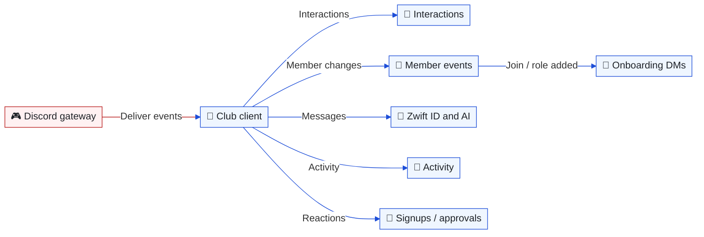
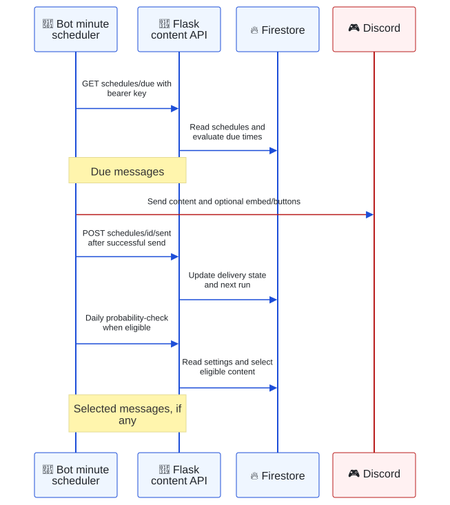
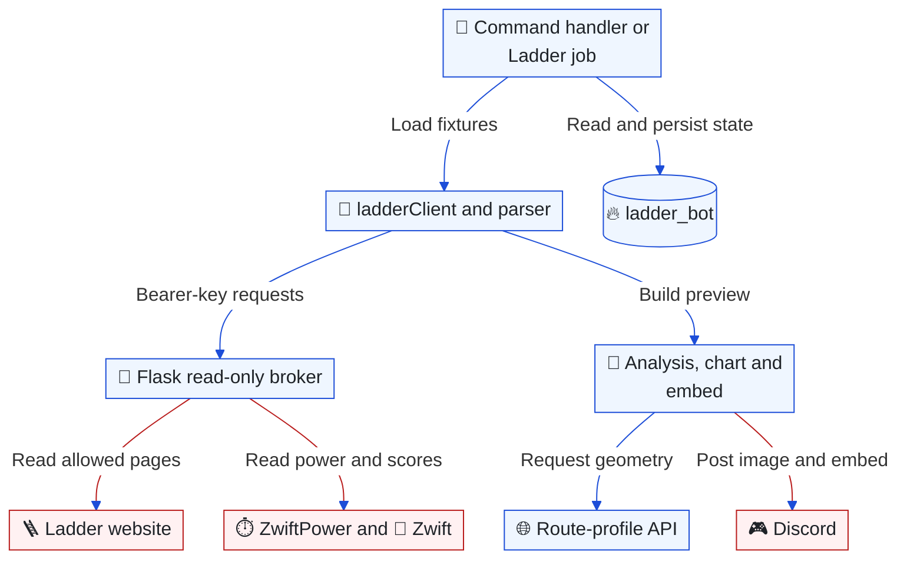
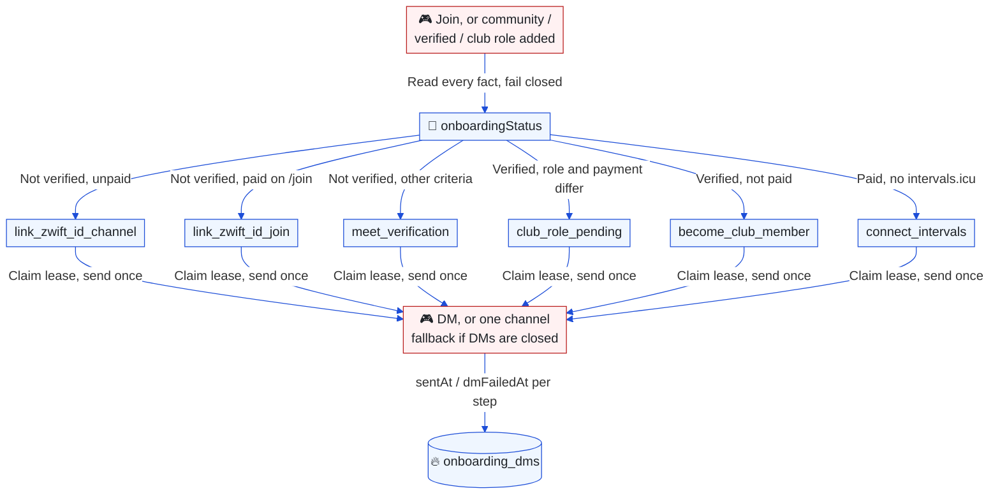

# Bot and automation

[Architecture index](README.md) · Parent: [runtime overview](overview.md#runtime-collaboration-what-actually-calls-what) · Related: [Coach](coach.md), [roles](identity-membership.md), [operations](operations.md)

## Discord event handling: which subsystem receives an event?

Purpose: trace the club bot's dispatch paths rather than treating every service as a separate bot.



<details>
<summary>Editable Mermaid source</summary>



</details>

[bot.js](../../apps/bot/bot.js) registers slash commands, attaches gateway handlers and starts the scheduler when ready. [interactionHandler](../../apps/bot/handlers/interactionHandler.js) routes slash commands and component IDs; changes to a command often require both a [declaration](../../apps/bot/commands/slashCommands.js) and its handler. Multiple listeners can observe one event: activity tracking is not an exclusive dispatch branch.

Member events trigger the public welcome/role one-liners, [onboarding DMs](#onboarding-dms-which-message-does-a-member-get), verification and New Member role maintenance. Role-panel prerequisites and captain/admin approval live in [roleService](../../apps/bot/services/roleService.js) and [approvalService](../../apps/bot/services/approvalService.js), as expanded in [membership](identity-membership.md#team-roles-how-does-approval-differ-from-verification).

Streaming commands, buttons and modals are intercepted before the generic interaction handler by [streamingHandlers](../../apps/bot/handlers/streamingHandlers.js), allowing modal responses without an earlier acknowledgement. The same process accepts OBS callbacks on its HTTP listener and runs a durable verification/announcement worker once Discord is ready. Guild departure revokes enrollment. See [OBS streaming](streaming.md) for member onboarding, provider verification, quota limits and delivery recovery.

The [club assistant](../../apps/bot/handlers/aiChatHandler.js) responds to mentions, replies to the bot and DMs. It routes coaching intent toward `/coach`; the optional [Coach client](../../apps/bot/services/coachBot.js) handles coaching DMs separately in the same process. Both use the stateless [Responses adapter](../../apps/bot/services/coachLlm.js), with independent model settings. The [helper agent service](../../apps/bot/services/helperAgent.js) supplies read-only research when a specialized tool cannot answer.

Activity is buffered and aggregated by [statsCollector](../../apps/bot/services/statsCollector.js) into `server_activity`; it is not a persistent raw message archive. Shutdown attempts to flush activity and Coach session notes, with a bounded grace period. Sudden termination can still lose in-memory work.

## Scheduled messages: who decides what is due?

Purpose: show the split between Flask scheduling decisions and bot delivery.



<details>
<summary>Copy Mermaid code for mermaid.ai/live</summary>

```text
---
config:
  theme: base
  themeVariables:
    primaryColor: '#eff6ff'
    primaryTextColor: '#1f2328'
    primaryBorderColor: '#1d4ed8'
    lineColor: '#1d4ed8'
    actorBkg: '#eff6ff'
    actorBorder: '#1d4ed8'
    actorLineColor: '#1d4ed8'
    signalColor: '#1d4ed8'
  sequence:
    messageFontSize: 12
    actorMargin: 20
    width: 120
    wrap: true
  themeCSS: |
    .actor-line { stroke-width: 0.5px !important; }
    .messageText { font-size: 12px !important; }
    :is(&) { background: #ffffff; }
    rect.actor[name="D"] { stroke: #b91c1c !important; fill: #fff1f2 !important; }
    .actor-line[name="D"] { stroke: #b91c1c !important; }
    [data-from="D"], [data-to="D"] { stroke: #b91c1c !important; }
---
sequenceDiagram
    participant T as 🔁 Bot minute scheduler
    participant A as 🌙 Flask content API
    participant F as 🔥 Firestore
    participant D as 🎮 Discord
    rect rgb(255, 255, 255)
    T->>A: GET schedules/due with bearer key
    A->>F: Read schedules and evaluate due times
    Note over A,T: Due messages
    T->>D: Send content and optional embed/buttons
    T->>A: POST schedules/id/sent after successful send
    A->>F: Update delivery state and next run
    end
```

</details>

Sources: [scheduler](../../apps/bot/services/scheduler.js), [contentApi](../../apps/bot/services/contentApi.js), [Flask schedule endpoints](../../apps/api/main.py). The network acknowledgment follows the Discord send. A crash or acknowledgment failure between them can permit a repeated post; this is not an exactly-once queue.

## Announcer: what does the bot post on its own?

Purpose: replace the hand-kept random pool (`scheduled_messages` with `schedule.type == "probability"`, no longer read by the bot) with posts the bot writes from live data, and personal DM reminders.

**Channel posts.** Once a day (`runHour:runMinute`, `bot_state/announcer.lastRunDate`) the bot gathers candidates from [signals](../../apps/bot/services/announcer/signals.js), picks one, has the model write it in Danish and posts it as a draft in the moderators channel with Publicér / Ret og publicér / Afvis. Nothing reaches a public channel without a moderator.

| Signal | Priority | Fires when |
| --- | --- | --- |
| `upcomingClubEvents` | 1 time-bound | DZR-tagged Zwift events in the next 3 days; a series name at most every 21 days |
| `newFeatures` | 1 time-bound | New commits on `main` of the monorepo (website, API and bot) via the GitHub API; the model keeps only member-facing changes or answers NOTHING |
| `unlinkedZwiftId` | 2 need | ≥15 community members, or ≥10 %, have no Zwift ID |
| `notInCompanionClub` | 2 need | ≥15 members with a Zwift ID are not in `companion_club_members` |
| `dmUnseen` | 2 need | ≥15 members got a bot DM ≥3 days ago and never reacted |
| `featureSpotlight` | 3 | A feature from the bot's own [catalog](../../apps/bot/services/announcer/featureCatalog.js): every member slash command and club-assistant tool, described by its own code description; featured longest ago first, least used in DMs (30 days) among equals. Shipped features from the commit log get one spotlight a month after their news |
| `evergreen` | 4 filler | A `bot_knowledge` article not featured for 90 days |

The pick skips topics on cooldown, topics with an open draft and a repeat of the last published kind (time-bound topics excepted). No new draft while two are open; drafts expire after 3 days.

[Pacing](../../apps/bot/services/announcer/pacing.js) is checked when a moderator presses Publicér, not when the draft is written: 10–20 local time, at most 1 a day and 3 a week, never on a day an admin posted in #announcements, never within 24 hours of any message in the target channel. A blocked post is queued and posted by the scheduler when a slot opens, or at once with "Post nu alligevel".

**DM reminders.** Server activity (message, reaction, voice join) schedules a look at the member 10–60 minutes later, at most every 12 hours. If the member is still active, [dmReminders](../../apps/bot/services/announcer/dmReminders.js) reads their onboarding status: `link_zwift_id_channel`, `link_zwift_id_join`, `connect_intervals`, else `join_companion` for verified members outside the Companion club. Limits: 7 days after any bot DM, 14 days between reminders to one member, 3 per step, 20 a day, never after closed DMs or 🔕 Ikke nu.

Onboarding DMs, reminders and the admin outreach page share one record, `onboarding_dms/{discordId}`: `lastBotDmAt` is written by all three, reminders under `reminders.<step>`. Discord gives no read receipts, so `/announcer_stats` reports proxies per step: sent, closed DMs (50007), engaged (replied or pressed a button), converted (did the step afterwards) and silent (an upper bound on "never saw it").

**Admin pages.** `/admin/announcer` holds every setting (on/off per topic, channels, pacing, thresholds, DM reminder limits), the pause switch, recent posts, the detected spotlight features with an on/off switch each (the bot publishes the catalog to `bot_state/announcer_features`; there are no feature texts to maintain) and the commit-log features, which can be skipped. `/admin/onboarding` holds the onboarding DM texts and the DM reminder texts. Defaults live in shared modules ([announcerSettings](../../packages/shared/announcerSettings.js), [reminderTexts](../../packages/shared/reminderTexts.js), [onboardingTexts](../../packages/shared/onboardingTexts.js)); admin changes are stored in `system_settings/announcer` (settings, `spotlightExcluded`, `dmReminders.texts.<step>`) and `system_settings/onboarding_texts` (`texts.<key>`), and reach the bot within its 5-minute cache. `/announcer_pause`, `/announcer_run`, `/announcer_preview_dm` and `/onboarding_preview` work in Discord as before.

## Scheduler: which work runs on a tick?

`startScheduler` checks immediately and then every 60 seconds. Each job supplies its own time window and state guards. Much of the sweep is sequential; it is not a durable job runner and a slow sweep can overlap a later tick. Ladder and Coach follow-ups add their own in-process overlap guards.

| Responsibility | Timing and state | Implementation |
| --- | --- | --- |
| Fixed-time posts (daily, weekly, monthly) | Minute checks | [scheduler](../../apps/bot/services/scheduler.js), [content API](../../apps/bot/services/contentApi.js) |
| Announcer and DM reminders | Daily draft at 09:15 Europe/Copenhagen; queue every 15 minutes; due reminders every tick | [announcer](../../apps/bot/services/announcer/index.js), [below](#announcer-what-does-the-bot-post-on-its-own) |
| New Member role and KMS status | Hourly member sweep; recurring status refresh | [newMemberService](../../apps/bot/services/newMemberService.js), [scheduler](../../apps/bot/services/scheduler.js) |
| Companion and ZwiftPower rosters | Daily configured minute, default 04:00 Europe/Paris; `bot_state` date markers | [contentApi](../../apps/bot/services/contentApi.js), [Flask roster jobs](../../apps/api/main.py) |
| ZwiftPower pace roles | Daily configured minute, default 07:00 Europe/Paris; **add-only**, old pace roles remain | [config](../../apps/bot/config/config.js), [zpRoleSync](../../apps/bot/services/zpRoleSync.js) |
| Weekly routes and Fifty results | Half-hour checks; route updates through the website, result fixes through Flask | [events guide](events.md#weekly-race-application-who-updates-the-live-event) |
| Route quiz | Configured daily probability check | [quizService](../../apps/bot/services/quizService.js) |
| Coach follow-ups | Opt-in cadence; catch-up window 08:00–11:00 Europe/Copenhagen | [follow-up service](../../apps/bot/services/coachFollowUp.js), [schedule rules](../../apps/bot/services/coachFollowUpSchedule.js) |
| Ladder previews and reminders | Internal ten-minute throttle; persisted posted IDs | [ladderJobs](../../apps/bot/services/ladder/ladderJobs.js) |
| Announcement index sync | Once a day (`bot_state` `announcement_index_sync`); live message events update it in between | [announcementIndex](../../apps/bot/services/announcementIndex.js) |

Exact-minute jobs can be missed during downtime. Follow-ups have a catch-up window; do not assume every job does. Host scheduling and any external callers of job endpoints are [operational uncertainties](findings.md#what-the-repository-cannot-establish).

## Ladder: how is a match preview built?

Purpose: locate fixture acquisition, rider enrichment, rendering and restart state.



<details>
<summary>Editable Mermaid source</summary>



</details>

`/ladder_link` registers teams; preview/analysis commands and [jobs](../../apps/bot/services/ladder/ladderJobs.js) reuse the [Ladder services](../../apps/bot/services/ladder/). The bot has no Ladder or Zwift login password. Flask's [`/ladder_page`](../../apps/api/main.py) accepts only allow-listed paths from [ladder.py](../../apps/api/ladder.py). Rider enrichment uses `/rider_data/{id}` and `/zwift_profile/{id}`; route geometry comes from the website [route-profile route](../../app/api/route-profile/route.ts).

Defaults: preview inside 65 minutes before start, match-day reminder from noon Copenhagen time. [ladderStore](../../apps/bot/services/ladder/ladderStore.js) loads documents into memory and serializes whole-document writes; this is restart persistence, not a multi-instance locking protocol. Post/send and marking state are separate operations. `/ladder_ai` adds OpenAI tactics analysis with per-user daily runs and a short-lived result cache; it shares the OpenAI integration but is not a Coach conversation.

## Onboarding DMs: which message does a member get?

Purpose: show that a role event only says a DM may be due, while the member's current state picks the message.



<details>
<summary>Editable Mermaid source</summary>



</details>

[onboardingStatus](../../apps/bot/services/onboardingStatus.js) reads roles, Zwift ID, verification criteria, paid membership and the intervals.icu connection, and returns one `nextStep`. The order follows `/join` (Discord, payment, Zwift ID): an unverified member always gets a Zwift ID step, even when payment and the club role briefly disagree mid-`/join`; only a verified member gets `club_role_pending`. `done` is status only, because connecting intervals.icu fires no Discord event. A failed read throws; a missing document (not paid, not connected, default verification settings) is a normal answer.

[onboardingDm](../../apps/bot/services/onboardingDm.js) sends Danish templates filled with live values ([clubFacts](../../apps/bot/services/clubFacts.js) reads the fee from the website's `/api/membership/settings`). The first step DM also carries a channel intro, whatever role triggered it: members added through `/join` never get a community-role event. Each step key is claimed in a Firestore transaction that writes a 60-second lease, sent once, and finished with `sentAt` or `dmFailedAt`; another error leaves the step open for the next event. A crash between the send and the finish can still repeat one DM. Closed DMs (Discord 50007) post one line in the welcome or Zwift ID channel. The DM is sent before the public welcome/role line, and those admin-edited texts can use `{dm_hint}`: it expands to a "look in your DMs" hint only when a DM went out just then, and to nothing otherwise. The same document records `communityAt`, `zwiftLinkedAt` and `clubJoinedAt` for the onboarding funnel; no message content is stored.

The club assistant reads the same status through `my_onboarding_status`, and the fee and teams through `club_overview`, so a reply in the DM cannot contradict the DM. Admins test with `/onboarding_preview` (a simulated status, real templates, nothing written) and `/onboarding_reset` (forget sent steps and mark the user as test, for alt-account runs).

[assistantDmStats](../../apps/bot/services/assistantDmStats.js) records how the club assistant is used in DMs, as metadata only: one `assistant_dm_events` document per DM turn (member, onboarding stage, tools, duration, outcome: answered, error, empty, no answer, or the code-detected Coach redirect), per-member and per-day counters, and reply counts on `onboarding_dms` for the funnel. The club client has the DirectMessageReactions intent and Message/Reaction partials so 👍/👎 on its DM replies reach a DM-only listener; ratings store the producing tools, never text, and the guild reaction listeners stay guild-only. The assistant calls `report_knowledge_gap` when nothing covers a DZR question; the topic is its own summary, merged by a normalized id, and the tool is exempt from the fulfillment screen because it is never the requested action. [`/admin/onboarding`](../../app/admin/onboarding/page.tsx) shows the funnel (Zwift ID linked within 7 days of the DM that asked, club member within 7 days of the first DM), weekly DM members, tools, ratings and open gaps, with a link that prefills a knowledge article.

The same page lists **Onboarding recipients** below the funnel, including members who never replied and rejected DM attempts. The existing [Admin API](../../app/api/admin/onboarding/route.ts) returns `onboardingRecipients` from the onboarding documents it already reads, with batched, shared username lookups. Each member has one expandable row of registered steps, purposes, timestamps and sent/rejected results. Search covers the whole list; Show more reveals 25 members at a time; timestamps use Europe/Copenhagen. These are existing step records, not a count or complete history of individual DMs: several steps can share one DM, and `/onboarding_reset` removes previous step state. Bot delivery and data collection are unchanged.

### Where the assistant's DZR knowledge comes from

Facts that change (fees, onboarding stage, teams, results) come from live tools. Club news comes from the announcements channel instead of hand-written articles: [announcementIndex](../../apps/bot/services/announcementIndex.js) keeps `announcement_index` current from message create/update/delete events plus a daily full sync, and `search_announcements` (club assistant and DZR Helper) ranks posts by OpenAI embedding similarity, with a fading boost for recently posted or edited posts and near-copies of recurring posts collapsed into the newest. Results carry the post date and, if later, the edit date, and both bots are told that when posts disagree the most recently posted or edited one is correct. Text in a post's images (a season calendar, a poster) is transcribed by a vision model when the post is indexed and searched with it; each image is read once and the transcription is kept per attachment, so editing the post's text does not read it again. Only normal posts by this bot or by current Admin-role holders are indexed; replies, threads, system messages and posts under 40 characters are not, so old member chat in the channel never becomes an answer.

When the assistant logs a new knowledge gap (or a solved one returns more than a week after its last draft), [gapDrafts](../../apps/bot/services/gapDrafts.js) asks DZR Helper to research it (announcements and knowledge base first, the web only for general Zwift facts) and posts a Danish draft article in the moderators channel with Publicér / Ret og publicér / Afvis buttons, or a "no answer found" note with a link to write one. Only members with Manage Messages or Administrator can press them. Publishing writes `bot_knowledge` (tags: category and `auto`) and marks the gap solved in one transaction; nothing reaches the knowledge base without that click. At most `GAP_DRAFTS_PER_DAY` (default 10) drafts run per day.

Linking a Zwift ID now shows who the ID belongs to before anything is stored: [riderIdentity](../../apps/bot/services/riderIdentity.js) reads Flask `/zwift_profile/{id}` (name, country, avatar, racing score) and `/rider_data/{id}` (ZwiftPower). A lookup error keeps the plain number-only confirm; only two clean misses show "not found" with "Link alligevel". The Zwift ID channel, `/my_zwiftid` (ID or name search) and the assistant in DMs all post the same confirm buttons, and linking happens on the button. Members who do not know their ID can search by name: [riderSearch](../../apps/bot/services/riderSearch.js) lists DZR club riders first, then ZwiftPower riders from Flask `/zp_rider_search` (the site's Riders tab search through the shared ZwiftPower account, 4+ characters, public fields only: name, country, category, team). Results are cached for 10 minutes and each member has a daily allowance (`ZP_RIDER_SEARCHES_PER_DAY`, default 20). The pick menu is bound to the member who searched, and picking opens the same confirm card. `/my_zwiftid` shows it ephemerally; when the assistant searches from a server channel it sends the menu by DM (falling back to the channel only when DMs are closed). `/my_zwiftid searchterm:` and the assistant ("tell me your Zwift name") use the same search, and the onboarding Zwift ID DMs invite members to send their name.
