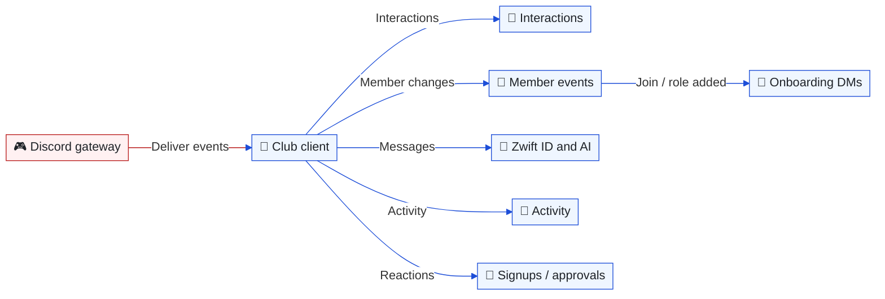
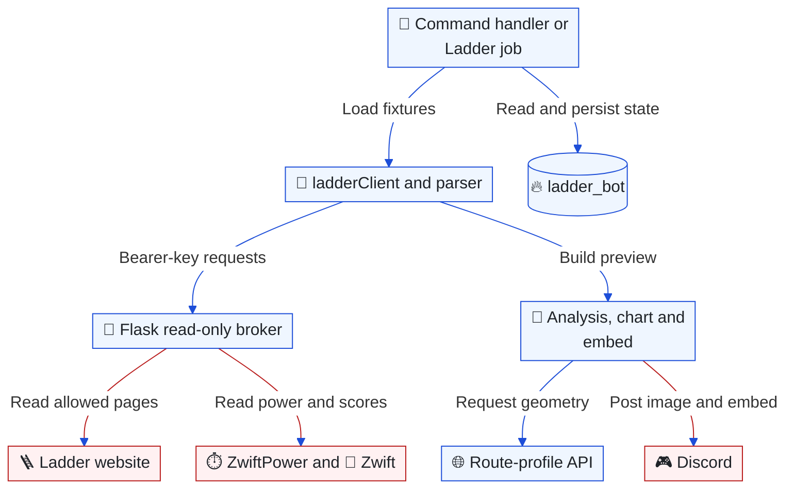
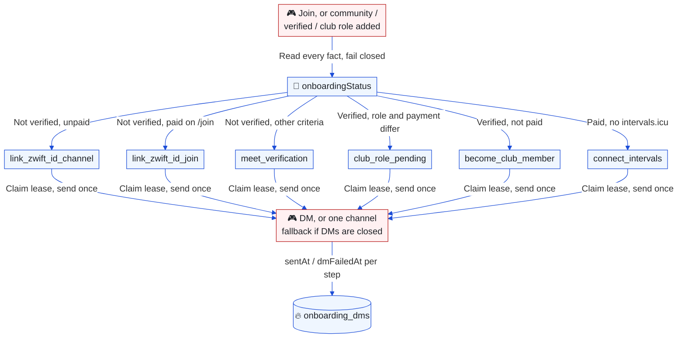

# Bot and automation

[Architecture index](README.md) · Parent: [runtime overview](overview.md#runtime-collaboration-what-actually-calls-what) · Related: [Coach](coach.md), [roles](identity-membership.md), [operations](operations.md)

## Discord event handling: which subsystem receives an event?

Purpose: trace the club bot's dispatch paths rather than treating every service as a separate bot.


<details>
<summary>Editable Mermaid source</summary>



</details>

[bot.js](../../apps/bot/bot.js) registers slash commands, attaches gateway handlers and starts the scheduler when ready. [interactionHandler](../../apps/bot/handlers/interactionHandler.js) routes slash commands and component IDs; changes to a command often require both a [declaration](../../apps/bot/commands/slashCommands.js) and its handler. Multiple listeners can observe one event: activity tracking is not an exclusive dispatch branch.

Member events trigger the public welcome/role one-liners, [onboarding DMs](#onboarding-dms-which-message-does-a-member-get), verification and New Member role maintenance. Role-panel prerequisites and captain/admin approval live in [roleService](../../apps/bot/services/roleService.js) and [approvalService](../../apps/bot/services/approvalService.js), as expanded in [membership](identity-membership.md#team-roles-how-does-approval-differ-from-verification).

Streaming commands, buttons and modals are intercepted before the generic interaction handler by [streamingHandlers](../../apps/bot/handlers/streamingHandlers.js), allowing modal responses without an earlier acknowledgement. The same process accepts OBS callbacks on its HTTP listener and runs a durable verification/announcement worker once Discord is ready. Guild departure revokes enrollment. See [OBS streaming](streaming.md) for member onboarding, provider verification, quota limits and delivery recovery.

The [club assistant](../../apps/bot/handlers/aiChatHandler.js) responds to mentions, replies to the bot and DMs. It routes coaching intent toward `/coach`; the optional [Coach client](../../apps/bot/services/coachBot.js) handles coaching DMs separately in the same process. Both use the stateless [Responses adapter](../../apps/bot/services/coachLlm.js), with independent model settings. The [helper agent service](../../apps/bot/services/helperAgent.js) supplies read-only research when a specialized tool cannot answer.

Activity is buffered and aggregated by [statsCollector](../../apps/bot/services/statsCollector.js) into `server_activity`; it is not a persistent raw message archive. Shutdown attempts to flush activity and Coach session notes, with a bounded grace period. Sudden termination can still lose in-memory work.

## Scheduled messages: who decides what is due?

Purpose: show the split between Flask scheduling decisions and bot delivery.


<details>
<summary>Copy Mermaid code for mermaid.ai/live</summary>

```text
---
config:
  theme: base
  themeVariables:
    primaryColor: '#eff6ff'
    primaryTextColor: '#1f2328'
    primaryBorderColor: '#1d4ed8'
    lineColor: '#1d4ed8'
    actorBkg: '#eff6ff'
    actorBorder: '#1d4ed8'
    actorLineColor: '#1d4ed8'
    signalColor: '#1d4ed8'
  sequence:
    messageFontSize: 12
    actorMargin: 20
    width: 120
    wrap: true
  themeCSS: |
    .actor-line { stroke-width: 0.5px !important; }
    .messageText { font-size: 12px !important; }
    :is(&) { background: #ffffff; }
    rect.actor[name="D"] { stroke: #b91c1c !important; fill: #fff1f2 !important; }
    .actor-line[name="D"] { stroke: #b91c1c !important; }
    [data-from="D"], [data-to="D"] { stroke: #b91c1c !important; }
---
sequenceDiagram
    participant T as 🔁 Bot minute scheduler
    participant A as 🌙 Flask content API
    participant F as 🔥 Firestore
    participant D as 🎮 Discord
    rect rgb(255, 255, 255)
    T->>A: GET schedules/due with bearer key
    A->>F: Read schedules and evaluate due times
    Note over A,T: Due messages
    T->>D: Send content and optional embed/buttons
    T->>A: POST schedules/id/sent after successful send
    A->>F: Update delivery state and next run
    T->>A: Daily probability-check when eligible
    A->>F: Read settings and select eligible content
    Note over A,T: Selected messages, if any
    end
```

</details>

Sources: [scheduler](../../apps/bot/services/scheduler.js), [contentApi](../../apps/bot/services/contentApi.js), [Flask schedule endpoints](../../apps/api/main.py). The network acknowledgment follows the Discord send. A crash or acknowledgment failure between them can permit a repeated post; this is not an exactly-once queue.

## Scheduler: which work runs on a tick?

`startScheduler` checks immediately and then every 60 seconds. Each job supplies its own time window and state guards. Much of the sweep is sequential; it is not a durable job runner and a slow sweep can overlap a later tick. Ladder and Coach follow-ups add their own in-process overlap guards.

| Responsibility | Timing and state | Implementation |
| --- | --- | --- |
| Fixed and probability-based posts | Minute checks; probability selection daily | [scheduler](../../apps/bot/services/scheduler.js), [content API](../../apps/bot/services/contentApi.js) |
| New Member role and KMS status | Hourly member sweep; recurring status refresh | [newMemberService](../../apps/bot/services/newMemberService.js), [scheduler](../../apps/bot/services/scheduler.js) |
| Companion and ZwiftPower rosters | Daily configured minute, default 04:00 Europe/Paris; `bot_state` date markers | [contentApi](../../apps/bot/services/contentApi.js), [Flask roster jobs](../../apps/api/main.py) |
| ZwiftPower pace roles | Daily configured minute, default 07:00 Europe/Paris; **add-only**, old pace roles remain | [config](../../apps/bot/config/config.js), [zpRoleSync](../../apps/bot/services/zpRoleSync.js) |
| Weekly routes and Fifty results | Half-hour checks; route updates through the website, result fixes through Flask | [events guide](events.md#weekly-race-application-who-updates-the-live-event) |
| Route quiz | Configured daily probability check | [quizService](../../apps/bot/services/quizService.js) |
| Coach follow-ups | Opt-in cadence; catch-up window 08:00–11:00 Europe/Copenhagen | [follow-up service](../../apps/bot/services/coachFollowUp.js), [schedule rules](../../apps/bot/services/coachFollowUpSchedule.js) |
| Ladder previews and reminders | Internal ten-minute throttle; persisted posted IDs | [ladderJobs](../../apps/bot/services/ladder/ladderJobs.js) |

Exact-minute jobs can be missed during downtime. Follow-ups have a catch-up window; do not assume every job does. Host scheduling and any external callers of job endpoints are [operational uncertainties](findings.md#what-the-repository-cannot-establish).

## Ladder: how is a match preview built?

Purpose: locate fixture acquisition, rider enrichment, rendering and restart state.


<details>
<summary>Editable Mermaid source</summary>



</details>

`/ladder_link` registers teams; preview/analysis commands and [jobs](../../apps/bot/services/ladder/ladderJobs.js) reuse the [Ladder services](../../apps/bot/services/ladder/). The bot has no Ladder or Zwift login password. Flask's [`/ladder_page`](../../apps/api/main.py) accepts only allow-listed paths from [ladder.py](../../apps/api/ladder.py). Rider enrichment uses `/rider_data/{id}` and `/zwift_profile/{id}`; route geometry comes from the website [route-profile route](../../app/api/route-profile/route.ts).

Defaults: preview inside 65 minutes before start, match-day reminder from noon Copenhagen time. [ladderStore](../../apps/bot/services/ladder/ladderStore.js) loads documents into memory and serializes whole-document writes; this is restart persistence, not a multi-instance locking protocol. Post/send and marking state are separate operations. `/ladder_ai` adds OpenAI tactics analysis with per-user daily runs and a short-lived result cache; it shares the OpenAI integration but is not a Coach conversation.

## Onboarding DMs: which message does a member get?

Purpose: show that a role event only says a DM may be due, while the member's current state picks the message.


<details>
<summary>Editable Mermaid source</summary>



</details>

[onboardingStatus](../../apps/bot/services/onboardingStatus.js) reads roles, Zwift ID, verification criteria, paid membership and the intervals.icu connection, and returns one `nextStep`. The order follows `/join` (Discord, payment, Zwift ID): an unverified member always gets a Zwift ID step, even when payment and the club role briefly disagree mid-`/join`; only a verified member gets `club_role_pending`. `done` is status only, because connecting intervals.icu fires no Discord event. A failed read throws; a missing document (not paid, not connected, default verification settings) is a normal answer.

[onboardingDm](../../apps/bot/services/onboardingDm.js) sends Danish templates filled with live values ([clubFacts](../../apps/bot/services/clubFacts.js) reads the fee from the website's `/api/membership/settings`). The community role adds a channel intro to the same message. Each step key is claimed in a Firestore transaction that writes a 60-second lease, sent once, and finished with `sentAt` or `dmFailedAt`; another error leaves the step open for the next event. A crash between the send and the finish can still repeat one DM. Closed DMs (Discord 50007) post one line in the welcome or Zwift ID channel. The DM is sent before the public welcome/role line, and those admin-edited texts can use `{dm_hint}`: it expands to a "look in your DMs" hint only when a DM went out just then, and to nothing otherwise. The same document records `communityAt`, `zwiftLinkedAt` and `clubJoinedAt` for the onboarding funnel; no message content is stored.

The club assistant reads the same status through `my_onboarding_status`, and the fee and teams through `club_overview`, so a reply in the DM cannot contradict the DM. Admins test with `/onboarding_preview` (a simulated status, real templates, nothing written) and `/onboarding_reset` (forget sent steps and mark the user as test, for alt-account runs).

[assistantDmStats](../../apps/bot/services/assistantDmStats.js) records how the club assistant is used in DMs, as metadata only: one `assistant_dm_events` document per DM turn (member, onboarding stage, tools, duration, outcome: answered, error, empty, no answer, or the code-detected Coach redirect), per-member and per-day counters, and reply counts on `onboarding_dms` for the funnel. The club client has the DirectMessageReactions intent and Message/Reaction partials so 👍/👎 on its DM replies reach a DM-only listener; ratings store the producing tools, never text, and the guild reaction listeners stay guild-only. The assistant calls `report_knowledge_gap` when nothing covers a DZR question; the topic is its own summary, merged by a normalized id, and the tool is exempt from the fulfillment screen because it is never the requested action. [`/admin/onboarding`](../../app/admin/onboarding/page.tsx) shows the funnel (Zwift ID linked or club joined within 7 days of the DM that asked), weekly DM members, tools, ratings and open gaps, with a link that prefills a knowledge article.

Linking a Zwift ID now shows who the ID belongs to before anything is stored: [riderIdentity](../../apps/bot/services/riderIdentity.js) reads Flask `/zwift_profile/{id}` (name, country, avatar, racing score) and `/rider_data/{id}` (ZwiftPower). A lookup error keeps the plain number-only confirm; only two clean misses show "not found" with "Link alligevel". The Zwift ID channel, `/my_zwiftid` (ID or name search) and the assistant in DMs all post the same confirm buttons, and linking happens on the button.
