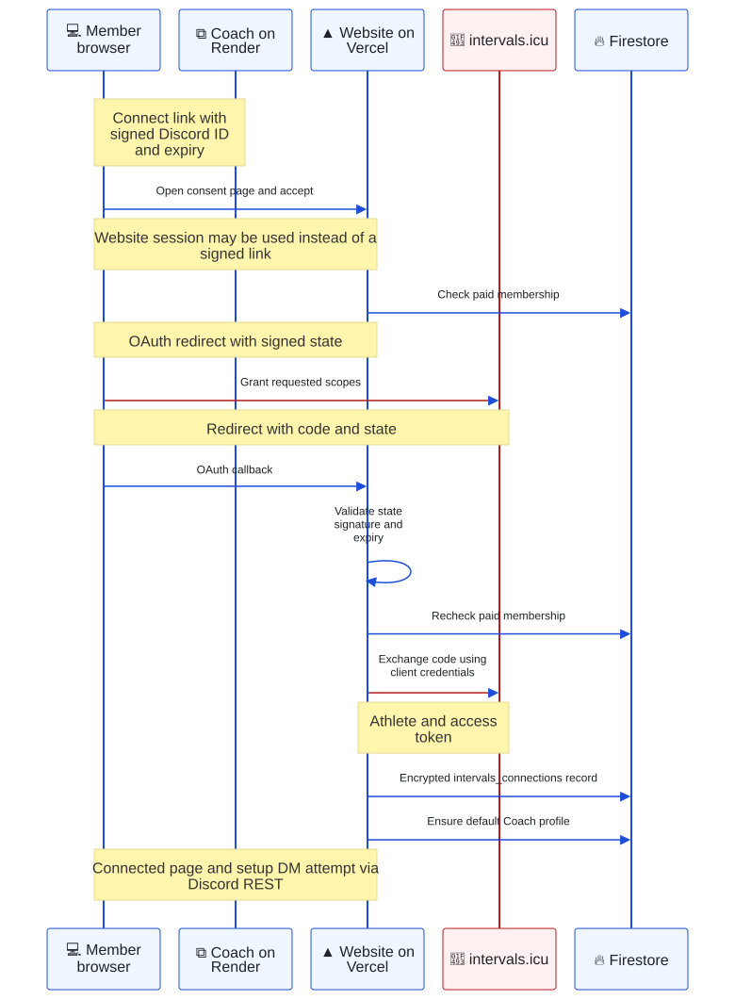
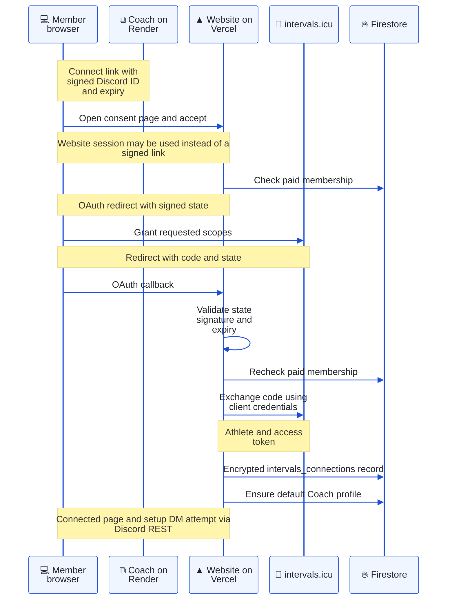
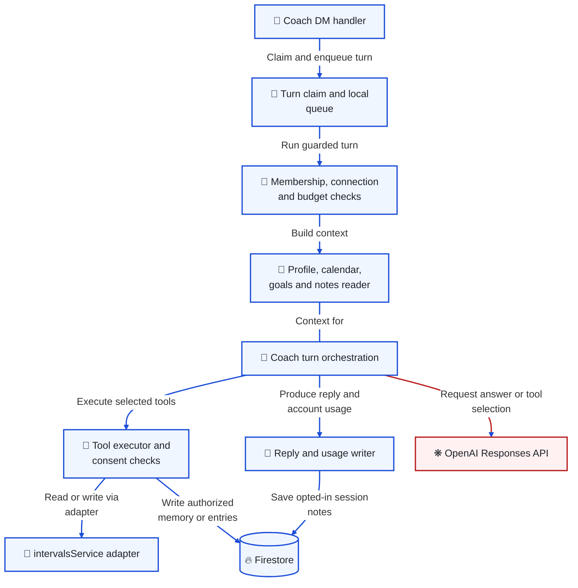
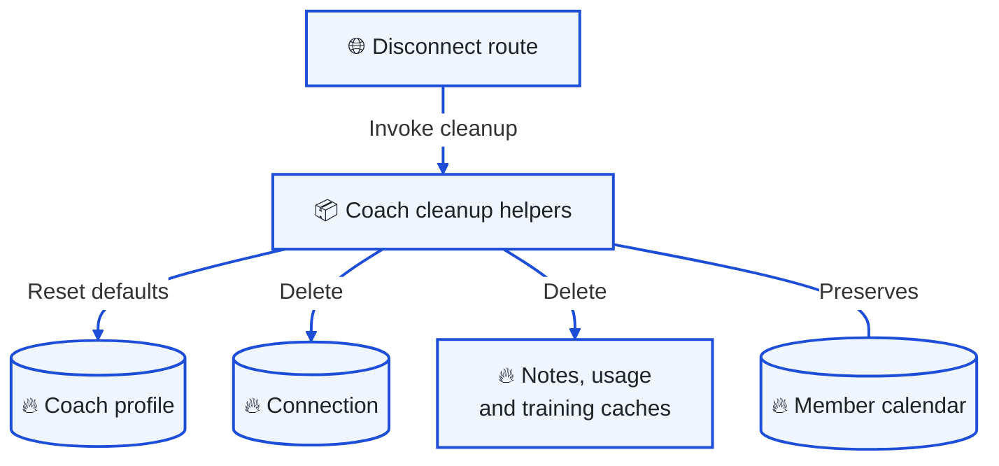

# DZR Coach

[Architecture index](README.md) · Parent: [overview](overview.md) · Related: [data ownership](data.md), [encryption boundaries](security.md#secrets-and-training-data-where-does-trust-change)

Coach is an optional Discord client in the Render bot process. The club bot owns `/coach`, which opens a DM from Coach. The website owns consent, OAuth callbacks and settings; the bot owns training retrieval, answer generation and follow-up DMs. The Flask API is not the intervals.icu OAuth callback or the primary training-data broker.

## Training connection: how is a Discord identity linked to an athlete?

Purpose: follow the signed connect link across Render, the website and intervals.icu.

Editable Mermaid source

Sources: [bot connect helper](../../apps/bot/services/intervalsService.js), [site signing and scopes](../../app/lib/intervalsAuth.ts), [connect route](../../app/api/intervals/connect/route.ts), [callback](../../app/api/intervals/callback/route.ts). A connect token lasts 15 minutes; OAuth state uses a 20-minute signed token. It is signed identity/expiry state, not a persisted single-use state record.

Scopes are `ACTIVITY:READ,WELLNESS:READ,SETTINGS:READ,CALENDAR:WRITE`. Despite names such as `hasClubMemberRole`, eligibility is the shared **paid current-year membership** predicate, not a Discord role lookup. Missing payment access fails closed. Vercel and Render must agree on signing and encryption keys.

## Coaching turn: what happens after a member sends a DM?

Purpose: identify the orchestration path and the places to add a tool, data computation or guard.

Editable Mermaid source

Start in [aiChatHandler](../../apps/bot/handlers/aiChatHandler.js): `handleCoachChatMessage` accepts DMs only; `runChatTurn` checks membership, connection and budget, composes context and runs a bounded tool loop. [turnClaim](../../apps/bot/services/turnClaim.js) creates a message claim to reduce duplicate answers during overlapping deployments; it fails open if Firestore is unavailable. [turnQueue](../../apps/bot/services/turnQueue.js) serializes each conversation locally and bounds pending work. Neither mechanism provides durable replay of unprocessed messages.

[coachLlm](../../apps/bot/services/coachLlm.js) uses the Responses API with `store: false`. Visible messages remain in process memory; encrypted reasoning is replayed only within the current turn's tool rounds. After restart or an idle timeout, recent Discord DM history can restore visible context. This is separate from opt-in persistent notes.

Tool declarations and availability are in [coachTools](../../apps/bot/services/coachTools.js); execution is in `executeSingleToolCall` in the handler. [intervalsService](../../apps/bot/services/intervalsService.js) fetches athlete settings, activities, wellness, curves and planned workouts. [streamMetrics](../../apps/bot/services/streamMetrics.js), [powerCurves](../../apps/bot/services/powerCurves.js) and [weeklyLoad](../../apps/bot/services/weeklyLoad.js) compute compact coaching evidence. Activities sourced from the Strava API are skipped as unreadable stubs; there is no Strava fallback integration.

A `401` from intervals.icu yields a reconnect request; the bot does not implement an OAuth refresh-token cycle. Workout generation uses [zwoBuilder](../../apps/bot/services/zwoBuilder.js) and writes planned events through intervals.icu. That is a different store from the DZR member calendar. [Goal confirmation](../../apps/bot/services/coachGoalConfirm.js) requires a member button response before saving proposed goals.

## Data lifecycle: what is retained, and what does disconnect remove?

Purpose: keep consent and deletion changes from erasing a member's independent calendar.

Editable Mermaid source

[Coach profile/notes APIs](../../app/api/coach/) and the [setup UI](../../components/coach/CoachSetupFlow.tsx) manage settings and member-entered memory. `notesOptIn` controls conversation-derived memory and related write tools; manually entered goals and the member's own calendar have separate behavior. Persistent text is encrypted using shared [tokenCrypto](../../packages/shared/coach/tokenCrypto.js) helpers. Do not assume every metadata field or numerical training cache is encrypted.

[Disconnect](../../app/api/intervals/disconnect/route.ts) calls [wipeCoachIntervals](../../app/lib/wipeCoachIntervals.ts): reset the profile, delete notes, feedback, usage, the connection, weekly-load and activity-metrics caches, and attempt a notification DM. Some deletions are best effort. [clearCoachData](../../app/lib/clearCoachData.ts) deliberately preserves `member_calendar`; it is not a promise to erase Discord messages, provider data or every operational record. Members revoke provider-side access in intervals.icu settings.

Follow-ups are initiated by the existing [scheduler](bot-automation.md#scheduler-which-work-runs-on-a-tick), using opt-in 3/7/14-day inactivity settings and a morning catch-up window. See [existing Coach notes](../coach-review.md) for integration context, and [operations](operations.md) for model checks and key coordination.
