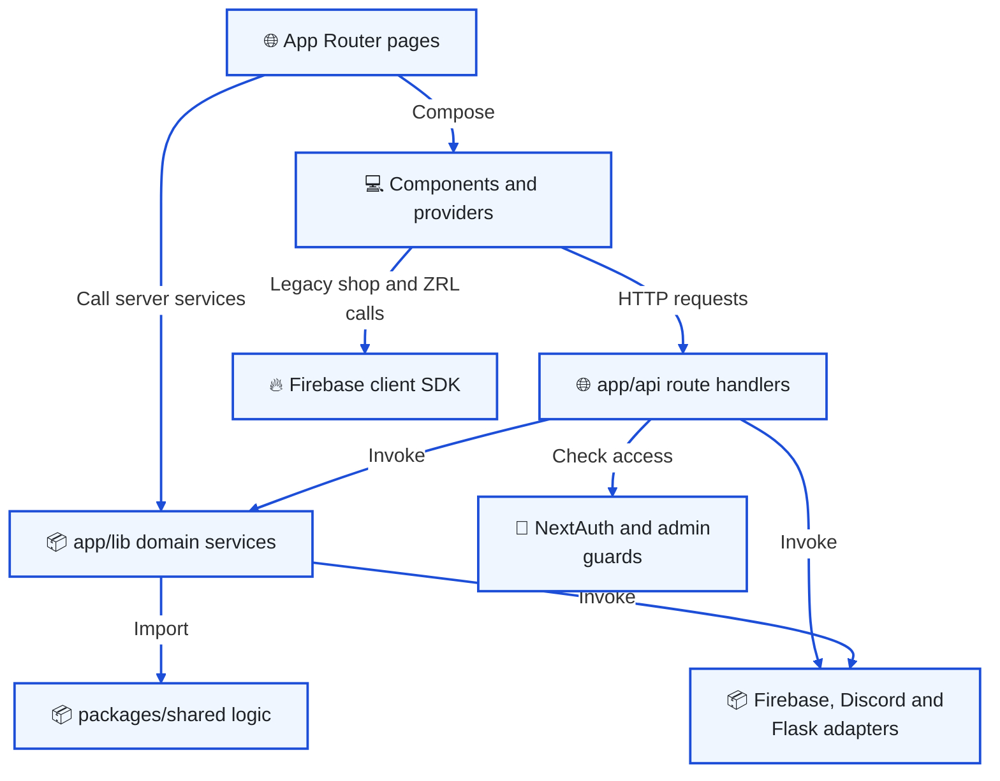
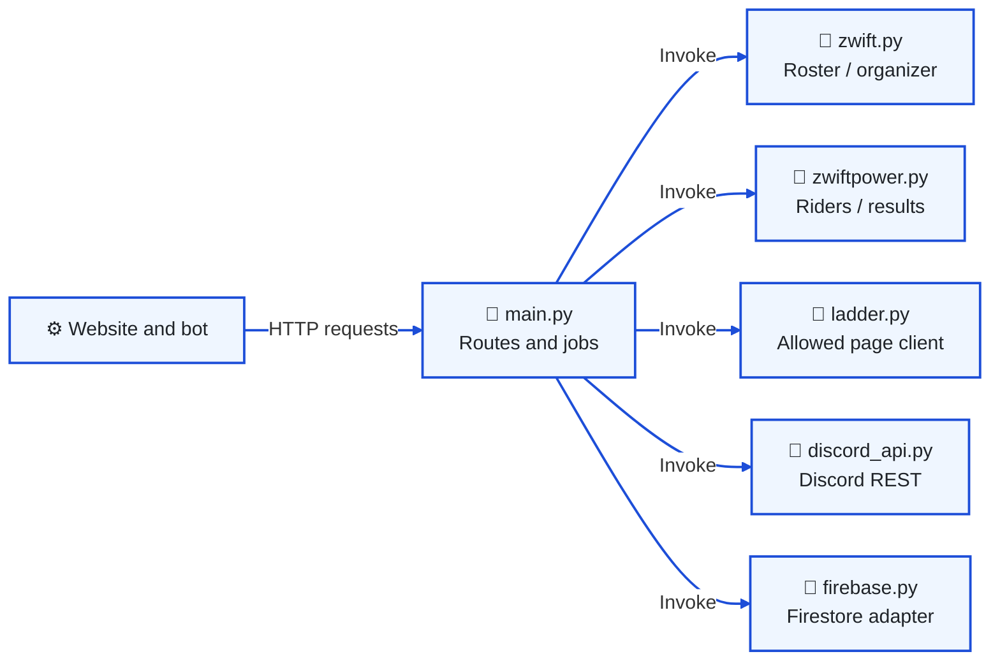
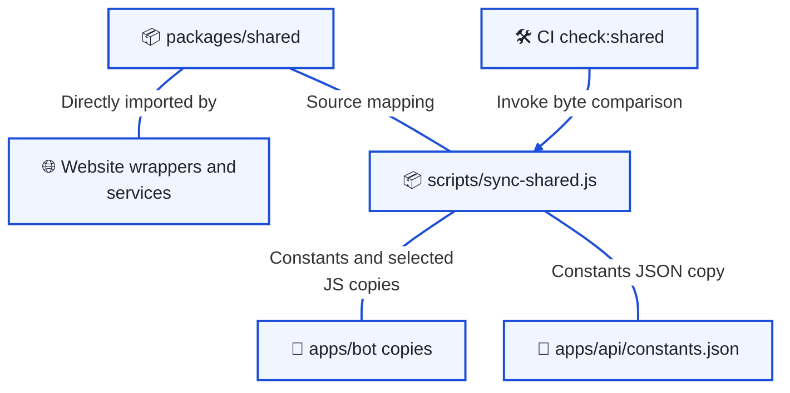

# Code map and shared modules

[Architecture index](README.md) · Parent: [runtime overview](overview.md#runtime-collaboration-what-actually-calls-what)

## Website responsibilities: where does a request go?

Purpose: locate changes by responsibility inside the Next.js deployment.

Page middleware only matches `/admin/**` and `/members-zone/**`. Server routes must perform their own checks. Domain services can persist data or call external services; they are not all pure functions. Shared modules accept runtime dependencies where needed, such as a Firestore handle for paid membership checks.

| Change | Start here | Follow across the boundary |
| --- | --- | --- |
| Navigation, public or member UI | [app](../../app/), [components](../../components/), [AppShell](../../app/AppShell.tsx) | [Providers](../../app/providers.tsx) and relevant route handler |
| Login and member access | [NextAuth route](../../app/api/auth/[...nextauth]/route.ts), [middleware](../../middleware.ts) | [Firebase bridge](../../app/api/auth/firebase-token/route.ts), [security guide](security.md) |
| Joining or payment coverage | [onboarding routes](../../app/api/onboarding/), [membership routes](../../app/api/membership/) | [Role synchronization](../../app/utils/discordRoleSync.ts), [membership guide](identity-membership.md) |
| Admin content, roles or signups | [admin routes](../../app/api/admin/), [admin components](../../components/admin/) | [`_lib` adapters and provisioning](../../app/api/admin/_lib/) |
| Race schedule, catalog or publishing | [seriesSchedule](../../app/lib/seriesSchedule.ts), [eventSeries](../../app/lib/eventSeries.ts), [seriesCatalog](../../app/lib/seriesCatalog.ts) | [Flask event APIs](../../apps/api/main.py), [events guide](events.md) |
| A Discord command or interaction | [slash command declarations](../../apps/bot/commands/slashCommands.js), [interaction dispatch](../../apps/bot/handlers/interactionHandler.js) | [Handlers](../../apps/bot/handlers/) → [services](../../apps/bot/services/) |
| A recurring bot job | [scheduler](../../apps/bot/services/scheduler.js) | [contentApi](../../apps/bot/services/contentApi.js), [automation guide](bot-automation.md) |
| Coach answer or tool | [aiChatHandler](../../apps/bot/handlers/aiChatHandler.js), [coachTools](../../apps/bot/services/coachTools.js) | [intervalsService](../../apps/bot/services/intervalsService.js), [Coach guide](coach.md) |
| Coach settings or memory | [Coach routes](../../app/api/coach/), [CoachSetupFlow](../../components/coach/CoachSetupFlow.tsx) | [Shared Coach models](../../packages/shared/coach/), [encryption](../../packages/shared/coach/tokenCrypto.js) |
| Credentialed Zwift integration | [Flask main](../../apps/api/main.py) | [zwift.py](../../apps/api/zwift.py), [zwiftpower.py](../../apps/api/zwiftpower.py), [ladder.py](../../apps/api/ladder.py) |

## Flask modules: where do integration changes belong?

Purpose: distinguish HTTP orchestration from provider-specific protocol handling in the Python runtime.

[main.py](../../apps/api/main.py) combines route registration, bearer checks, cached authenticated sessions and job orchestration. [zwift.py](../../apps/api/zwift.py), [zwiftpower.py](../../apps/api/zwiftpower.py) and [ladder.py](../../apps/api/ladder.py) own provider-specific requests and parsing. [discord_api.py](../../apps/api/discord_api.py) supplies Discord REST operations, and [firebase.py](../../apps/api/firebase.py) initializes Firestore with ADC and provides data helpers. The Flask module name does not make these independent services.

Change an external protocol in its adapter, and change caller authorization or the job contract in the route. Next's [flask adapter](../../app/api/admin/_lib/flask.ts) and the bot's [content API client](../../apps/bot/services/contentApi.js) are important consumers. Flask jobs execute when an endpoint is invoked; `main.py` does not start the bot's periodic scheduler. Legacy commentary orchestration additionally uses [zwiftcommentator.py](../../apps/api/zwiftcommentator.py); its posting path is [unresolved](findings.md#incomplete-and-legacy-paths).

## Shared source: why are there copies in the apps?

Purpose: prevent fixing a deployed copy while leaving its canonical source unchanged.

There are deliberately **no npm workspaces**. Vercel installs the root package; Render installs `apps/bot`; Cloud Run's documented source root is `apps/api`. A bot import outside that directory would not exist in its build context.

The [sync script's `TARGETS`](../../scripts/sync-shared.js) is the authoritative copy list: constants, selected Coach modules, phenotype and verification criteria. Other shared modules, including series rotation and route matching, are imported by the website without a bot copy. JavaScript declarations beside shared modules provide TypeScript interfaces.

Edit the source, run `npm run sync:shared`, and commit source **and** changed copies. CI's `npm run check:shared` compares bytes. This also matters to deployment: Render's build filter watches `apps/bot/**`; a shared-only edit does not trigger its build. [Operations](operations.md#shared-change-delivery-what-must-be-committed-together) explains the delivery path.

Use the existing boundary for a new feature. Do not add a shared copy unless both runtimes need that behavior. Keep the runtime's SDK initialization in [website Firebase utilities](../../app/utils/), [bot Firebase service](../../apps/bot/services/firebase.js) or [Flask Firebase adapter](../../apps/api/firebase.py).
