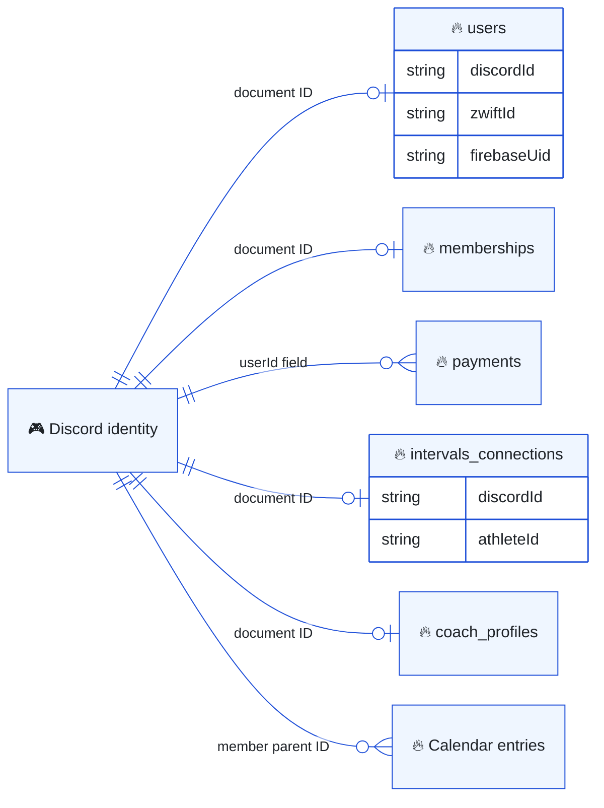
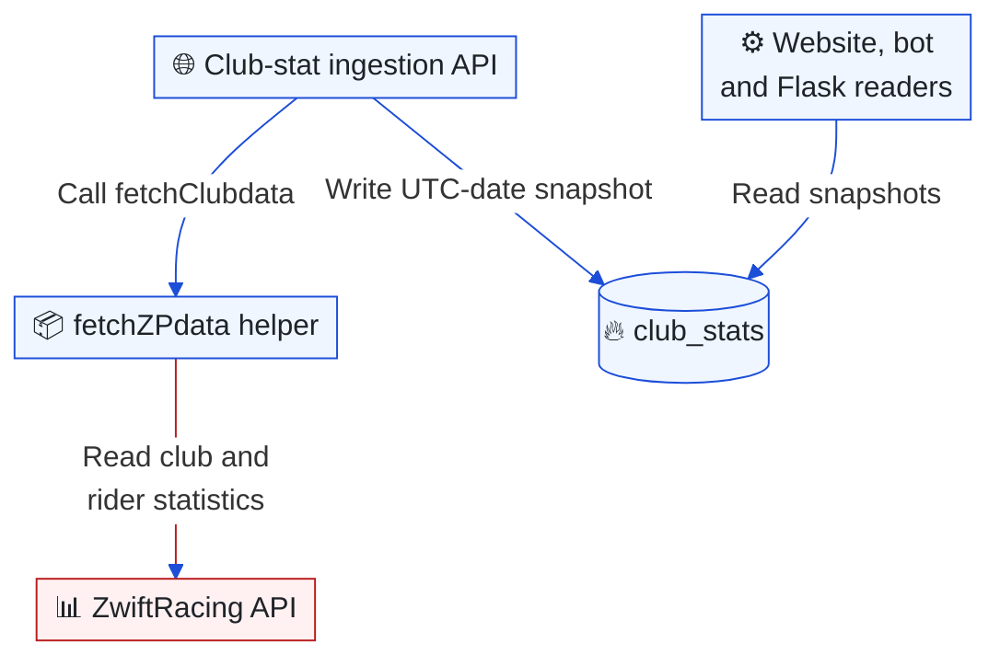
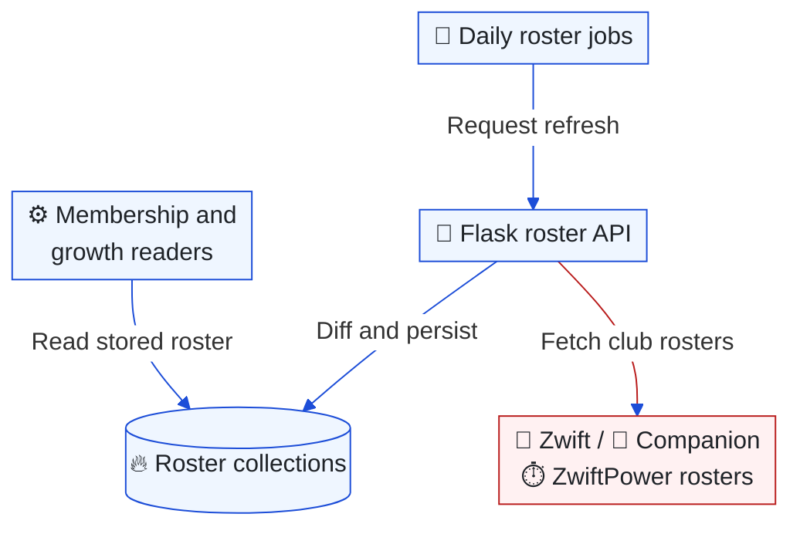

# Data ownership and flows

[Architecture index](README.md) · Parent: [runtime overview](overview.md#runtime-collaboration-what-actually-calls-what) · Related: [security](security.md), [Coach lifecycle](coach.md#data-lifecycle-what-is-retained-and-what-does-disconnect-remove)

Firestore is a shared integration store, not three isolated application databases. “Owner” below means the feature that defines semantics and lifecycle; several runtimes can write the same collection. The [constants](../../packages/shared/constants.json) name many collections but do not enumerate all of them. Literal collection names also occur in feature modules.

## Identity relationships: which key links a member's records?

Purpose: show the logical joins that matter when moving between website, Discord and training data. This is not a complete Firestore schema or a set of enforced foreign keys.

Editable Mermaid source

Discord snowflake IDs, Zwift IDs, Firebase Auth UIDs and intervals.icu athlete IDs are different identities. `users/{discordId}` bridges the first three. [Firebase token issuance](../../app/api/auth/firebase-token/route.ts) prefers an existing Firebase account by email, then a saved UID, otherwise creates one. A Firebase UID need not equal the `users` document ID. [Flask link updates](../../apps/api/firebase.py), website onboarding and the bot can all maintain Discord-to-Zwift links.

Coach notes and calendar entries are subcollections beneath Discord-ID parents. Payments use `checkout_{reference}` IDs for Vipps checkout, with a `userId` field linking the Discord identity. A missing user document does not necessarily mean there is no paid-membership or Coach record.

## Ownership map: where should a new field or write live?

| Data / storage | Semantics and main writers | Main readers / constraints |
| --- | --- | --- |
| `users` | Website identity bridge/onboarding/member APIs, bot ID linking, Flask linkage | All runtimes resolve Discord ↔ Zwift; browser rules differ from Admin SDK access |
| `payments`, `memberships` | Website checkout/callback/confirm and admin reconciliation; Flask retains membership endpoints | Website and bot paid-member predicate; membership is a coverage rollup |
| `onboarding_sessions` | Website session and join handlers | Cookie-correlated public flow; expiry checked on access |
| `system_settings/global` | Website admin and Flask settings endpoints | Membership options, content scheduling and role configuration |
| `verificationSettings`, `selfRoles`, `roleApprovals` | Bot verification/roles/approval; website also edits self-role panels | Discord policy and approval lifecycle; Discord remains actual role state |
| `role_updates` | Website role mutation fallback | No in-repository consumer found; do not promise automatic retry |
| `welcome_messages`, `role_messages`, `scheduled_messages`, `bot_knowledge` | Website admin collection routes; Flask content endpoints | Bot content and assistant services; Flask computes schedule eligibility |
| `bot_state`, `chat_turn_claims` | Bot job markers and per-message claims | Operational coordination; claims have expiry fields, TTL policy is external |
| `signup_board_configs`, `signup_boards` | Website admin and bot signup service | Reaction/button enrollment and admin review |
| `series_catalogs`, `series_schedules`, `event_series`, `group_ride_schedules` | Website planning/publishing; Flask updates Fifty result markers | Public/member event views, bot automation and result jobs; [events guide](events.md) |
| `club_stats` | Website ZwiftRacing ingestion route; legacy Flask queue enrichment can also update snapshots | Website stats, bot rider tools, role sync and Flask member views |
| `companion_club_members`, `zwiftpower_club_members`, `zwiftpower_roster_counts` | Flask roster refresh endpoints | Membership/growth comparisons and admin views; empty fetch does not clear stored roster |
| `server_activity`, `server_member_counts` | Bot activity summaries; website admin stats writes member-count snapshots | Admin analytics; operational records are separate from Coach notes |
| `intervals_connections` | Website OAuth callback; bot can migrate legacy token fields | Website status and bot training tools; tokens encrypted, client SDK denied |
| `coach_profiles`, `coach_chat_notes/{id}/notes` | Website settings/notes and bot Coach memory | Shared validation/encryption; consent governs conversation-derived notes |
| `member_calendar/{id}/entries` | Website member calendar and authorized bot tools | Website and Coach; encrypted text, independent member lifecycle |
| `coach_usage`, `coach_usage_daily`, `coach_usage_events`, `coach_feedback` | Bot accounting and ratings; website cleanup | Daily budgets, admin Coach reporting; disconnect cleanup |
| `coach_weekly_load`, `coach_activity_metrics` | Bot training calculations and caches | Rebuildable training evidence; disconnect cleanup, not canonical provider records |
| `ladder_bot` | Bot Ladder store | Teams, rider cache and posted IDs; local memory backed by serialized JSON documents |
| `orders`, `teams`, `riders` | Legacy browser shop and ZRL components | Firebase Auth plus Firestore rules, not NextAuth role claims alone |
| Firebase Storage series logos | Website `eventSeries` via Admin Storage SDK | Served by website logo route; separate from Firestore documents |

Key adapters: [website Firebase Admin](../../app/utils/firebaseAdminConfig.js), [browser Firebase](../../app/utils/firebaseConfig.js), [bot Firebase](../../apps/bot/services/firebase.js), [Flask Firebase](../../apps/api/firebase.py). Storage logo writes are in [eventSeries](../../app/lib/eventSeries.ts). This map selects important collections; it is not an exhaustive data dictionary.

## Statistics flow: where does a rider's score come from?

Purpose: distinguish daily ZwiftRacing snapshots from authenticated ZwiftPower reads and roster membership.

Editable Mermaid source

[fetchZPdata](../../app/utils/fetchZPdata.ts), despite its filename, calls `api.zwiftracing.app` for rider/club data and maps `zrs.score` to `racingScore`. [Club ingestion](../../app/api/zr/club/[club]/route.ts) stores `club_stats/{UTC-date}` with a 31-day expiry field. The writer does not establish that a Firestore TTL policy exists. A later request that day overwrites that date's snapshot.

The bot reads latest/daily snapshots for many stats tools, while Ladder can request fresh ZwiftPower W/kg and a Zwift profile through Flask. Flask's rider queue is explicitly labeled legacy: it is no longer needed to supply racing scores to the member view. Do not introduce a new dependency on that queue based on older docs.

## Club rosters: how is membership refreshed?

Purpose: show the requests behind the roster collections separately from rider-performance snapshots.

Editable Mermaid source

[Flask roster refresh](../../apps/api/main.py) compares fetched members to stored records and protects against an empty or ID-less response deleting the roster. “Companion” identifies the club-roster feature visible in the app; Flask reads the Zwift API rather than automating the mobile application. The triggering schedule is in the bot, but this repository does not establish who periodically calls website club-stat ingestion. See [operational gaps](findings.md#what-the-repository-cannot-establish).

## Client rules versus feature ownership

[firestore.rules](../../firestore.rules) governs browser SDK access. Admin SDKs bypass those rules and rely on server route/tool checks. The client permits authenticated reads/writes for `orders`, `teams` and `riders`; `users` permits authenticated reads and writes only when `request.auth.uid == userId`. Because `users/{discordId}` may have a different Firebase UID, do not assume that browser writes to that document succeed.

Coach/membership/calendar/Ladder client access is explicitly denied; other unmatched collections are denied by default. Stored expiry fields, encryption and application-level ownership are separate mechanisms. Index definitions are in [firestore.indexes.json](../../firestore.indexes.json), with deployment pointers in [firebase.json](../../firebase.json); live rule, index and TTL configuration needs separate verification.
