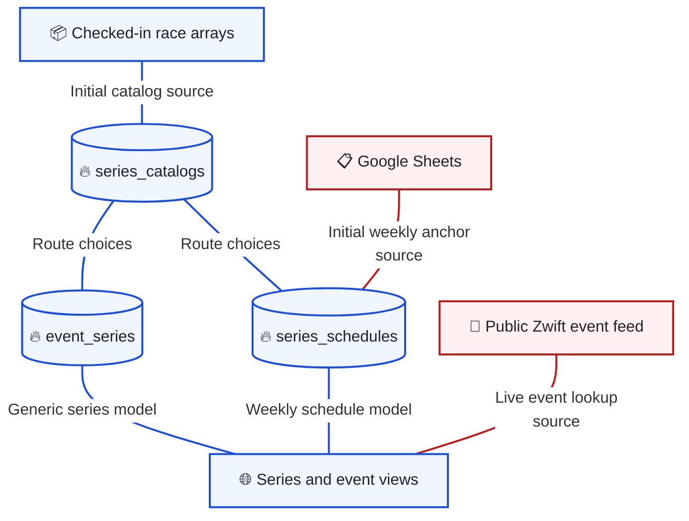
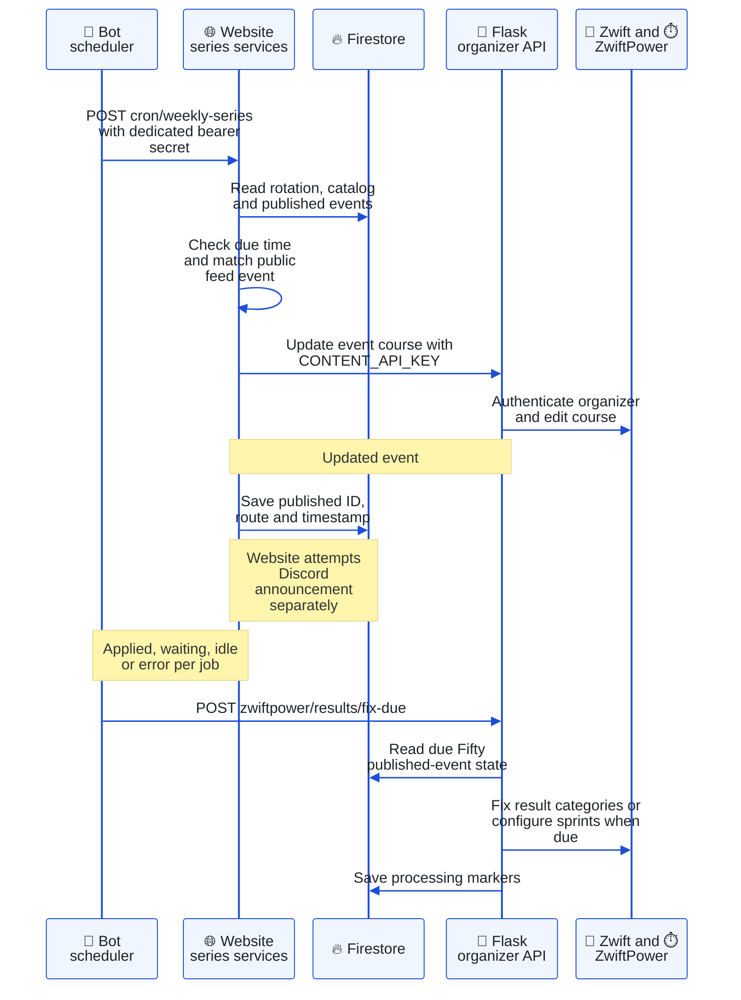
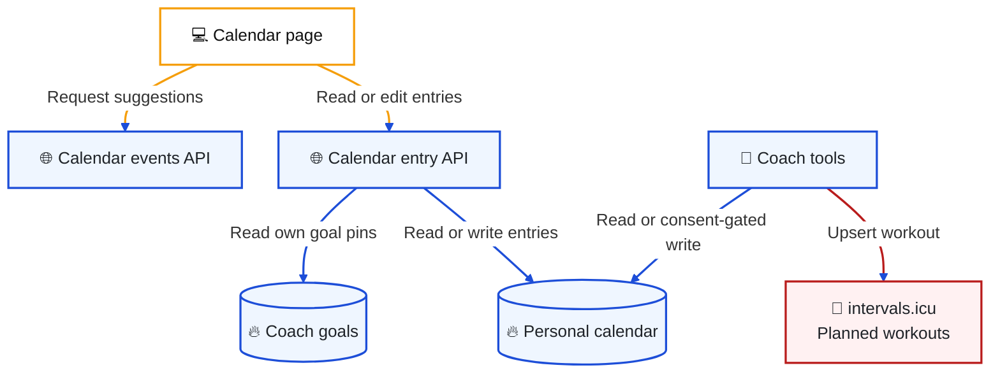

# Events and calendars

[Architecture index](README.md) · Parent: [overview](overview.md) · Related: [automation](bot-automation.md), [data](data.md)

## Race definitions: which source controls the displayed route?

Purpose: distinguish editable planning, the live Zwift feed and the two series models.

[seriesCatalog](../../app/lib/seriesCatalog.ts) seeds After Party and Zwifty Fifty routes from checked-in arrays, then stores editable catalogs. [seriesSchedule](../../app/lib/seriesSchedule.ts) seeds weekly rotation from a published [Google Sheets](../../services/google-sheets.action.ts) row only when the stored schedule is absent. Sheets are not continuously synchronized back from Firestore.

[eventSeries](../../app/lib/eventSeries.ts) is a separate, generic model for configured series, date overrides, multiple starts, publication and logos. [groupRide](../../app/lib/groupRide.ts) has another schedule for Always a Race. These are implemented parallel models, not aliases for one collection. The route catalog is shared by callers; keep the correct schedule model when adding a feature.

[zwiftPublicEvents](../../app/lib/zwiftPublicEvents.ts) fetches upcoming DZR events; [shared event shaping](../../packages/shared/zwiftEvents.js) normalizes them. Applying a route updates an event that already exists on Zwift. The website does not create a season of Zwift events from its schedule. [Route lookup](../../app/lib/zwiftRouteLookup.ts), [shared rotation](../../packages/shared/seriesRotation.js) and [automation rules](../../packages/shared/seriesAutomation.js) supply matching and timing logic.

## Weekly race application: who updates the live event?

Purpose: follow the unusual Render → Vercel → Google Cloud Run path and the separate result-fix job.

Sources: [bot contentApi](../../apps/bot/services/contentApi.js), [cron route](../../app/api/cron/weekly-series/route.ts), [seriesApply](../../app/lib/seriesApply.ts), [groupRide](../../app/lib/groupRide.ts), [seriesDiscord](../../app/lib/seriesDiscord.ts), [Flask routes](../../apps/api/main.py), [ZwiftPower adapter](../../apps/api/zwiftpower.py). The bot attempts these checks on the half hour; the website decides whether each route is due. Weekly race routes wait until at least 24 hours after the previous event start and for a matching new event. Group ride uses its own due logic.

Fifty WKG categories are rechecked from 1.5 through 4 hours after the start so later finishers are included. Sprint configuration is due about a day after Apply. A prior category change does not suppress every later check inside the window. These details matter when changing job state or retry logic.

An authorized event editor can also apply changes through [weekly-series routes](../../app/api/admin/events/series/) or [generic event-series routes](../../app/api/admin/events/event-series/). Admin status alone is insufficient: [requireEventEditor](../../app/api/admin/_lib/auth.ts) also checks `ZWIFT_EVENT_EDITOR_DISCORD_ID`. Flask keeps organizer credentials separate from the roster account.

External edits, published-state writes and Discord posts are separate steps. A successful route update can return an announcement error; partial failure is not automatically rolled back. Inspect stored state and provider results before repeating a manual apply.

## Calendar boundaries: does adding a race schedule a workout?

Purpose: distinguish personal planning, Coach goals, provider workouts and signup boards.

[Calendar events](../../app/api/calendar/events/route.ts) offers upcoming feed suggestions, not a complete season. Copying a suggestion into [calendar entries](../../app/api/calendar/route.ts) is not a subscription: later race changes do not automatically rewrite the copied entry. A stored racing score is only a category hint; the member chooses. WTRL-organized ZRL events are not supplied by the DZR-tagged feed.

The personal calendar is session-gated. Paid members can additionally see goal pins projected from Coach notes; goals are not duplicated as calendar entries. Coach tools apply their own consent and entry limits. Writing a DZR calendar row and writing an intervals.icu workout are distinct operations with independent deletion behavior. [Coach disconnect](coach.md#data-lifecycle-what-is-retained-and-what-does-disconnect-remove) preserves the member calendar.

[Signup boards](../../apps/bot/services/signupService.js) use `signup_board_configs` and `signup_boards`, with website [admin helpers](../../app/api/admin/_lib/signupBoards.ts). KMS uses Discord role membership and a periodically updated message. Legacy ZRL [components](../../components/ZRL/) use Firebase `teams` and `riders`. These are separate race participation mechanisms; a calendar entry does not imply registration in any of them.

Route profile images used by both website and bot are computed by [the website route-profile API](../../app/api/route-profile/route.ts), using [route elevation](../../app/lib/routeElevation.ts), `zwift-data` streams and [Sauce segment data](../../data/sauce-route-segments.json). [Next tracing configuration](../../next.config.mjs) explicitly includes those runtime files for Vercel. Keep that dependency when changing the renderer.
