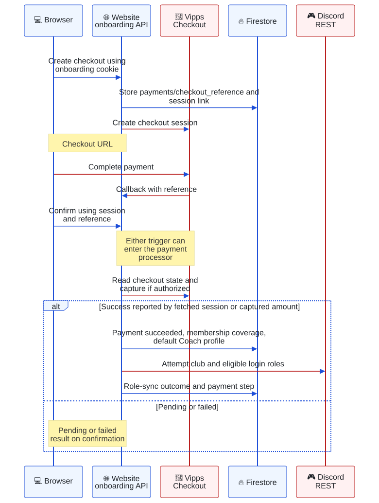
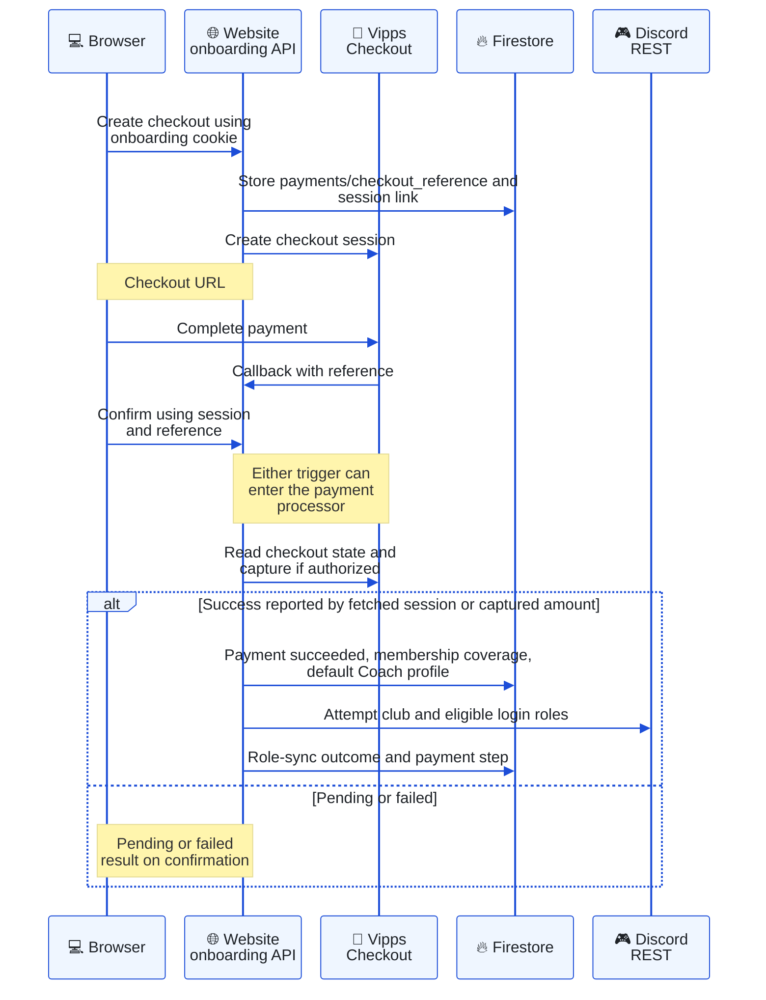
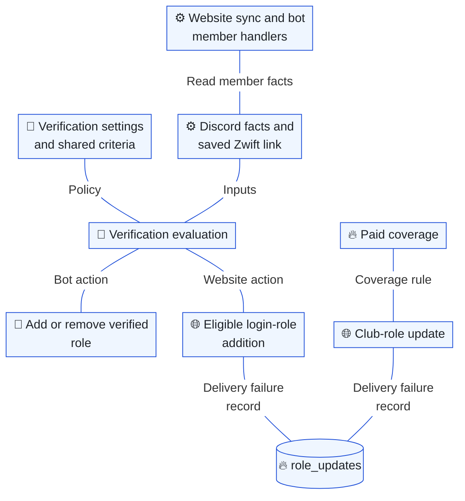
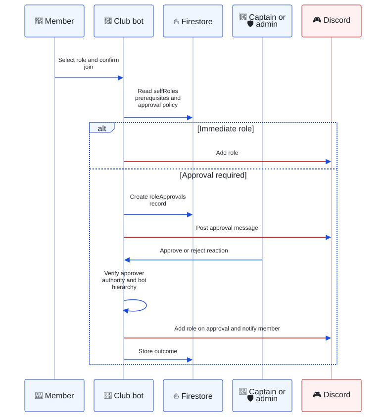
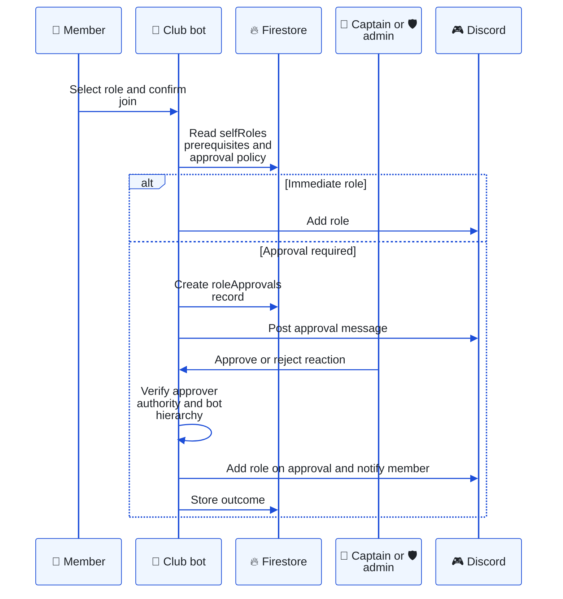

# Identity, membership and Discord roles

[Architecture index](README.md) · Parent: [overview](overview.md) · Related: [security](security.md), [data](data.md)

## Joining lifecycle: what must a new member complete?

Purpose: distinguish the public onboarding session from a website login session. These states are journey milestones, not the stored `status` enum.

```mermaid
---
config:
  themeCSS: |
    .edgeLabel, .edgeLabel p { font-size: 12px !important; }
  theme: base
  themeVariables:
    primaryColor: '#eff6ff'
    primaryTextColor: '#1f2328'
    primaryBorderColor: '#1d4ed8'
    lineColor: '#1d4ed8'
---
stateDiagram-v2
    state "⚙️ Onboarding session" as Session
    state "⚙️ Discord linked" as DiscordLinked
    state "⚙️ Payment covered" as Paid
    state "⚙️ Complete" as Complete
    state "⚙️ Session unavailable" as Unavailable
    [*] --> Session: Open join flow
    Session --> DiscordLinked: Discord OAuth callback
    DiscordLinked --> Paid: Checkout confirmed or existing coverage
    Paid --> Complete: Save Zwift ID and attempt role sync
    Complete --> [*]
    Session --> Unavailable: Cookie or record expires
    DiscordLinked --> Unavailable: Cookie or record expires
    Paid --> Unavailable: Cookie or record expires
    Unavailable --> Session: Start a new session
```

Editable Mermaid source

`/join` currently follows **Discord → payment → Zwift ID**. [Session helpers](../../app/api/onboarding/_lib/session.ts) store a 24-hour `onboarding_sessions` document and an HMAC-signed, HTTP-only cookie. Expiry checks reject the session; the diagram does not claim a worker writes the stored `expired` status or deletes the document.

[Discord start](../../app/api/onboarding/discord/start/route.ts) requests `identify email guilds.join`. The [callback](../../app/api/onboarding/discord/callback/route.ts) verifies stored OAuth state, resolves the Discord identity and optionally joins the guild using `DISCORD_ONBOARDING_BOT_TOKEN`. A skipped or failed guild join does not stop the recorded Discord-link step. This flow works before the member qualifies for NextAuth login.

The [status route](../../app/api/onboarding/status/route.ts) recognizes existing membership coverage. The [Zwift ID route](../../app/api/onboarding/zwift-id/route.ts) checks payment coverage, validates ID format, stores `users/{discordId}`, attempts access-role synchronization and marks onboarding complete. Format validation alone does not prove ownership of a Zwift account. Completion does not guarantee all Discord role operations succeeded.

## Payment processing: when is membership granted?

Purpose: follow onboarding checkout from local correlation to access side effects.

Editable Mermaid source

Sources: [create](../../app/api/onboarding/payment/create/route.ts), [confirm](../../app/api/onboarding/payment/confirm/route.ts), [callback](../../app/api/onboarding/payment/callback/route.ts), [processor](../../app/api/onboarding/_lib/payment.ts), [Vipps client](../../app/api/membership/vippsClient.ts). The callback acknowledges invalid authorization without processing. Confirmation verifies the local record belongs to the onboarding session. These writes and Discord calls are sequential side effects, not a distributed transaction or an exactly-once guarantee.

Existing members have a separate [membership checkout family](../../app/api/membership/vipps-checkout/). Its confirmation checks the signed-in user against the payment. Its callback differs materially: an invalid callback token is logged but processing continues, and incoming `sessionState` contributes to its success decision. Do not generalize the onboarding sequence's trust checks to that route. See [security limitations](security.md#existing-boundaries-and-limitations).

`payments` holds payment records; `memberships` is a current coverage rollup. The [shared paid-member predicate](../../packages/shared/coach/membership.js) accepts `currentStatus: club` covering the current UTC year, or falls back to succeeded payment records with coverage. Coach uses this predicate even if the user already has a verified Discord role.

## Verification and role delivery: who decides eligibility?

Purpose: distinguish a shared eligibility rule from the two mechanisms that deliver Discord roles.

Editable Mermaid source

The [shared criteria](../../packages/shared/verificationCriteria.js) default to requiring a Zwift ID; optional criteria cover account age, specific roles and server boosting. `requiresActivityThreshold` is reserved and is not evaluated. [Bot verification](../../apps/bot/services/verificationService.js) serializes work per guild/member, fetches fresh Discord state, and may add **or remove** the configured verified role. Lookups that fail must not be treated as evidence of ineligibility.

The [website helper](../../app/utils/discordRoleSync.ts) assigns eligible login roles and separately updates the configured paid club role. Despite its name, `syncMemberRoleOnLogin` is called from onboarding/member-update paths; it is not the NextAuth access predicate. Failed Discord mutations can create `role_updates`, but **no consumer is present in this repository**. A `queued` result is not evidence of eventual delivery.

[Admin reconciliation](../../app/api/admin/membership/reconcile/route.ts) independently rebuilds membership coverage from succeeded payments and adds/removes the club role. It is an explicit admin operation, not a discovered periodic queue consumer. ZwiftPower pace-group roles are another independent, add-only job described under [automation](bot-automation.md#scheduler-which-work-runs-on-a-tick).

## Team roles: how does approval differ from verification?

Purpose: show the bot's self-service role approval path; paid membership and verification are separate policies.

Editable Mermaid source

Sources: [interaction dispatch](../../apps/bot/handlers/interactionHandler.js), [roleService](../../apps/bot/services/roleService.js), [approvalService](../../apps/bot/services/approvalService.js). The website also manages role panels and provisions roles/channels via [admin helpers](../../app/api/admin/_lib/). Captain [add](../../app/api/team/add-member/route.ts) / [remove](../../app/api/team/remove-member/route.ts) routes check both captain role and configured ownership of the selected team, then call Discord directly.
