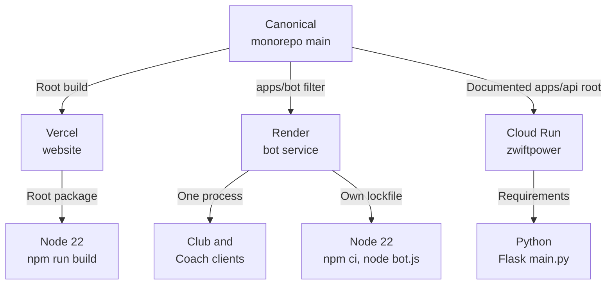
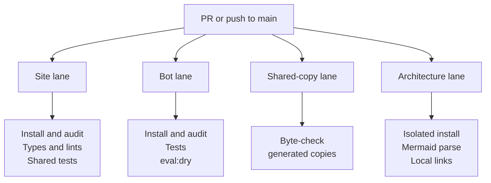
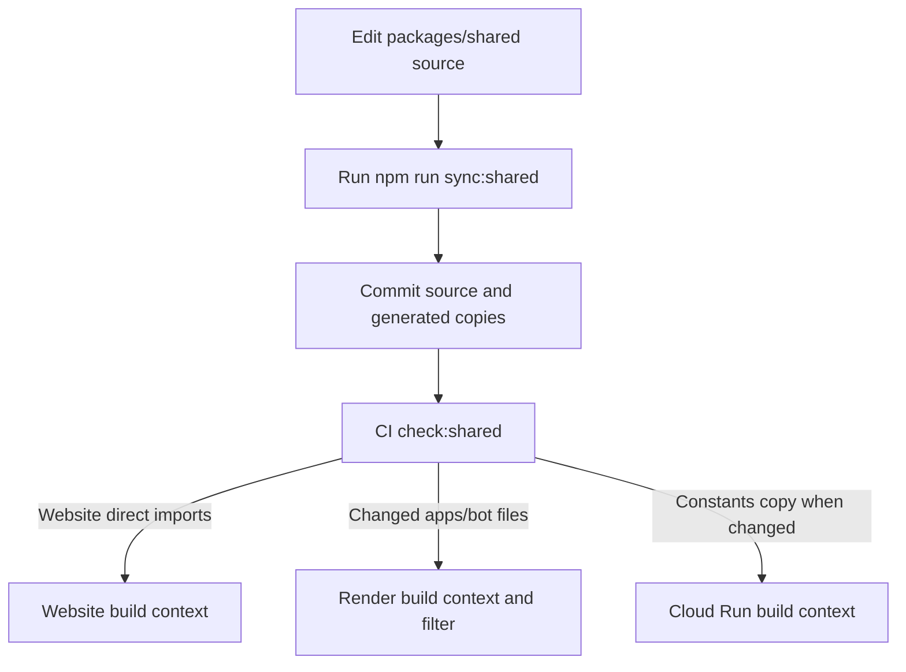

# Operations and delivery

[Architecture index](README.md) · Parent: [runtime overview](overview.md#runtime-collaboration-what-actually-calls-what) · Related: [shared modules](code-map.md#shared-source-why-are-there-copies-in-the-apps), [maintenance](maintenance.md)

## Deployment boundaries: what is built independently?

Purpose: separate checked-in deployment evidence from provider-managed wiring.

The root [README](../../README.md) and app [canonical notes](../../apps/api/CANONICAL.md) identify Vercel and Cloud Run production services. [render.yaml](../../render.yaml) explicitly describes Render `bot`, Oregon, starter plan, `rootDir: apps/bot`, commit auto-deploy and `apps/bot/**` build filter. It disables previews. Applying it as a new Blueprint could create a second bot; it is not a setup step for a documentation contributor.

| Runtime | Repository evidence | Health and operational implications |
| --- | --- | --- |
| Website | Root [package](../../package.json), [.nvmrc](../../.nvmrc), [Next config](../../next.config.mjs); no `vercel.json` | Pages and server routes; route-profile files explicitly included in output tracing |
| Bot | [render.yaml](../../render.yaml), own [package](../../apps/bot/package.json) / [lockfile](../../apps/bot/package-lock.json) / [.nvmrc](../../apps/bot/.nvmrc) | `GET /` returns `Bot is running!`; health does not prove Discord login, job progress or Coach readiness |
| Flask | [main.py](../../apps/api/main.py), [requirements](../../apps/api/requirements.txt), [canonical notes](../../apps/api/CANONICAL.md) | `GET /` returns service JSON; default port 8080; credentialed integrations initialize/cache sessions on demand |

No Cloud Run build/deploy workflow, Dockerfile or Vercel project linkage is checked in. Live source repository, branch, project credentials, scaling, deploy approvals and external schedules cannot be verified from these files. The diagram's production source is the documented canonical repository; a contributor's fork branch is for review, not a production deployment instruction.

## CI: which checks block drift in the repository?

Purpose: locate verification lanes and make clear that the workflow contains checks, not deployment commands.

See [.github/workflows/ci.yml](../../.github/workflows/ci.yml). Site dependencies are installed at root; bot dependencies are installed under `apps/bot`. Bot CI disables install scripts because tests do not need the native `canvas` binary. A passing unit test suite is therefore not a rendered chart smoke test. There is no Python test lane in the existing workflow.

Coach's `eval:dry` checks prompt structure without an API key. Live model comparisons are opt-in, incur API calls and are described in the root README; do not confuse the dry run with a measured model-quality result. Architecture tooling is isolated under [scripts/architecture](../../scripts/architecture/) and does not change either application lockfile.

Provider auto-deploy configuration is independent of this workflow. Nothing here proves deployments wait for CI to pass. Review [findings](findings.md#what-the-repository-cannot-establish) before assuming such a gate exists.

## Shared change delivery: what must be committed together?

Purpose: show why a shared-source edit needs synchronized files in the bot/API build contexts.

The [explicit mapping](../../scripts/sync-shared.js) decides which files are copied. Bot-only code stays in the bot. Shared JS is not copied to Python. A stale checked-in copy fails CI; copying during local development does not by itself deploy anything.

When a change spans Flask and its callers, keep their interfaces compatible during separate deployments. Ladder needs its Flask read endpoints available before a bot using them runs. Weekly automation additionally needs the same `WEEKLY_SERIES_CRON_SECRET` on Render and Vercel. Coach signing and encryption require [coordinated keys](security.md#secrets-and-training-data-where-does-trust-change).

Operational state lives partly in Firestore and partly in process memory. Deploy overlap is handled specifically for AI messages via claims; Ladder and scheduler markers are not universal distributed locks. Inspect [job behavior](bot-automation.md#scheduler-which-work-runs-on-a-tick) before adding a second bot instance or changing scheduling assumptions.
