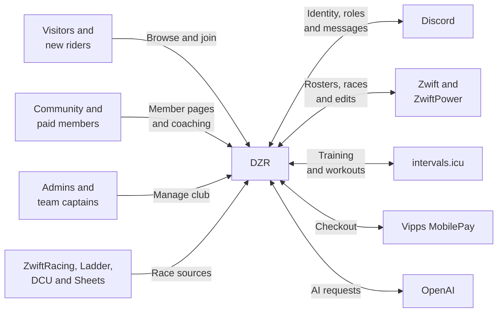
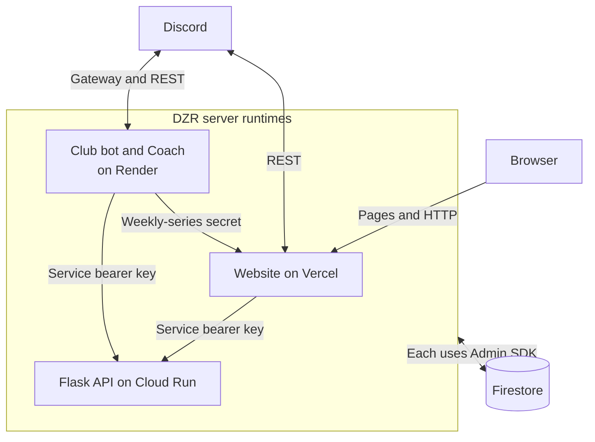

# System overview

[Architecture index](README.md) · Next: [code map](code-map.md)

## System context: who uses DZR and what supplies it?

Purpose: identify the people and external systems a contributor will encounter, without exposing internal modules.

Visitors browse race series and join. Verified community members can use the member area; paid membership separately unlocks Coach. Admins manage content, membership and Discord configuration. Event editing additionally requires a configured Discord account. Captains can manage their own teams. See [access rules](security.md#access-decisions-which-gate-applies).

External providers have different jobs: ZwiftRacing supplies club statistics, ZwiftPower supplies rider/results data, and the Ladder site supplies fixtures. Their APIs are not interchangeable. [Data flows](data.md#statistics-flow-where-does-a-riders-score-come-from) and [Ladder](bot-automation.md#ladder-how-is-a-match-preview-built) expand those distinctions.

## Runtime collaboration: what actually calls what?

Purpose: show the three deployment units and their primary working interfaces.

The service bearer key is `CONTENT_API_KEY`. All three runtimes read/write Firestore with Admin SDKs; Flask uses Application Default Credentials. See [data ownership](data.md) for their different write responsibilities.

The website contains public pages, `/join`, `/members-zone`, `/admin` and `/api/**`. It calls Discord directly for several operations; a route named `/api/discord-bot/...` does not imply a call to the Render process. Its member calendar and Coach settings use server routes, while older shop and ZRL components access Firestore from the browser.

The bot keeps Discord gateway connections open and owns a minute scheduler. Coach is an optional second Discord client, not a fourth deployed service. The Flask API brokers credentialed race integrations, content scheduling and roster jobs. Its former human admin pages return `410`; administration is on the website.

The reverse bot → website arrow is specifically weekly race automation. There is no implemented general-purpose Flask → Render message API: the bot HTTP server currently exposes health only. See [findings](findings.md#incomplete-and-legacy-paths) before relying on older commentary instructions.

Implementation: [Next routes](../../app/api/), [bot entry point](../../apps/bot/bot.js), [Flask routes and guards](../../apps/api/main.py), [bot health server](../../apps/bot/services/server.js), [Render definition](../../render.yaml).

Continue with [module boundaries](code-map.md), [Coach](coach.md), [data ownership](data.md) or [deployment evidence](operations.md).
