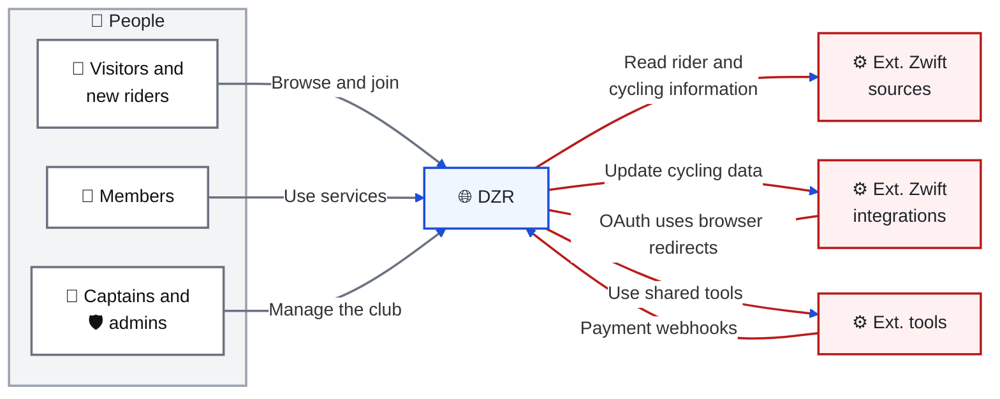
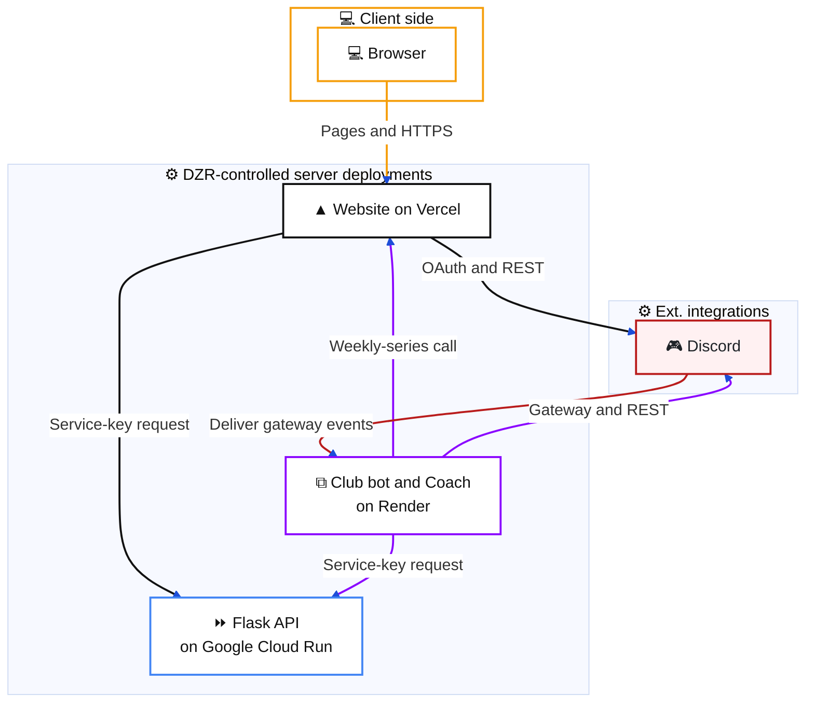

# System overview

[Architecture index](README.md) · Next: [code map](code-map.md)

## System context: who uses DZR and what supplies it?

Purpose: identify the people and external systems a contributor will encounter, without exposing internal modules.

Editable Mermaid source

Visitors browse race series and join. Verified community members can use the member area; paid membership separately unlocks Coach. Admins manage content, membership and Discord configuration. Event editing additionally requires a configured Discord account. Captains can manage their own teams. See [access rules](security.md#access-decisions-which-gate-applies).

The human boundary contains people. 🌐 and ⚙️ identify software systems; the complete [icon and color legend](../../.agents/skills/mermaid-architecture/SKILL.md) distinguishes specific human roles and machine providers. Every arrow points to the recipient of a request. A read points **from DZR to its source**, even though the returned data travels back to DZR.

The external groups describe purpose. “Zwift” here means the cycling ecosystem, not ownership by Zwift. Providers intentionally appear in more than one list when DZR both reads and updates them:

| Purpose group | Providers and implemented responsibilities |
| --- | --- |
| **Ext. Zwift sources** | 🧡 **Zwift:** public events, route/profile data and rosters, including 🩵 **Zwift Companion App** club membership. ⏱️ **ZwiftPower:** rider power/category data, race results and club rosters. 📊 **ZwiftRacing:** individual and club rider statistics, including aggregated performance/ranking data and racing scores. 🪜 **Ladder:** fixtures and signups. 🇩🇰 **DCU:** E-serien race calendar and scoring-segment information. 📋 **Google Sheets:** initial weekly-series anchor and legacy race-calendar rows. 💓 **intervals.icu:** athlete settings, activities, wellness, power curves and planned workouts. |
| **Ext. Zwift integrations** | 🧡 **Zwift:** update existing event courses/tags. ⏱️ **ZwiftPower:** adjust result categories and configure sprint scoring. 💓 **intervals.icu:** upsert planned workouts. These write integrations do not mean DZR owns the source records or creates all upstream events. |
| **Ext. tools** | 🎮 **Discord:** identity, roles, gateway events, channels and DMs. 🔵 **Vipps MobilePay:** membership checkout, status and capture. ❋ **OpenAI:** assistant, coaching and race-analysis requests. |

See [statistics provenance](data.md#statistics-flow-where-does-a-riders-score-come-from), [Ladder](bot-automation.md#ladder-how-is-a-match-preview-built), [event updates](events.md#weekly-race-application-who-updates-the-live-event) and [Coach](coach.md) for their different contracts. The [technology stack](tech-stack.md) separately shows hosting, browser libraries and server libraries.

## Runtime collaboration: what actually calls what?

Purpose: show the three deployment units and their primary working interfaces.

Editable Mermaid source

The service bearer key is `CONTENT_API_KEY`. Arrows identify the recipient of each request. Gateway event delivery back to the bot is expanded in the [bot event diagram](bot-automation.md#discord-event-handling-which-subsystem-receives-an-event). The [technology stack](tech-stack.md) expands shared persistence and execution zones. All three runtimes read/write Firestore with Admin SDKs; Flask uses Application Default Credentials. See [data ownership](data.md) for their different write responsibilities.

The website contains public pages, `/join`, `/members-zone`, `/admin` and `/api/**`. It calls Discord directly for several operations; a route named `/api/discord-bot/...` does not imply a call to the Render process. Its member calendar and Coach settings use server routes, while older shop and ZRL components access Firestore from the browser.

The bot keeps Discord gateway connections open and owns a minute scheduler. Coach is an optional second Discord client, not a fourth deployed service. The Flask API brokers credentialed race integrations, content scheduling and roster jobs. Its former human admin pages return `410`; administration is on the website.

The reverse bot → website arrow is specifically weekly race automation. There is no implemented general-purpose Flask → Render message API: the bot HTTP server currently exposes health only. See [findings](findings.md#incomplete-and-legacy-paths) before relying on older commentary instructions.

Implementation: [Next routes](../../app/api/), [bot entry point](../../apps/bot/bot.js), [Flask routes and guards](../../apps/api/main.py), [bot health server](../../apps/bot/services/server.js), [Render definition](../../render.yaml).

Continue with the [client/server technology stack](tech-stack.md), [module boundaries](code-map.md), [Coach](coach.md), [data ownership](data.md) or [deployment evidence](operations.md).

Incoming interactions include Vipps payment webhooks and Discord gateway events. Discord and intervals.icu OAuth callbacks arrive through browser redirects, rather than provider-to-server webhooks. See [payment processing](identity-membership.md) and [Coach connection](coach.md).
