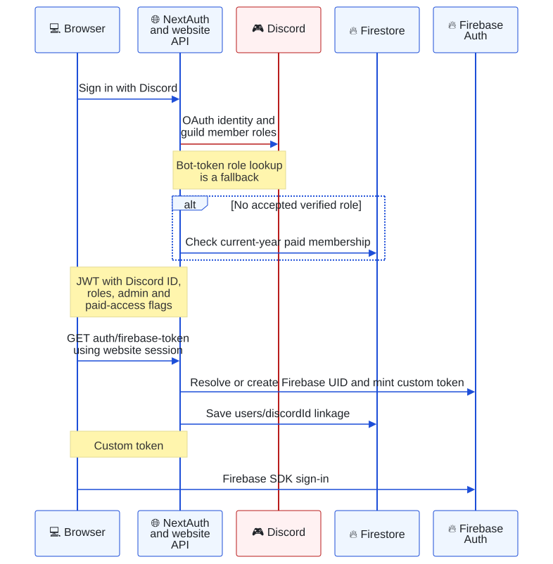
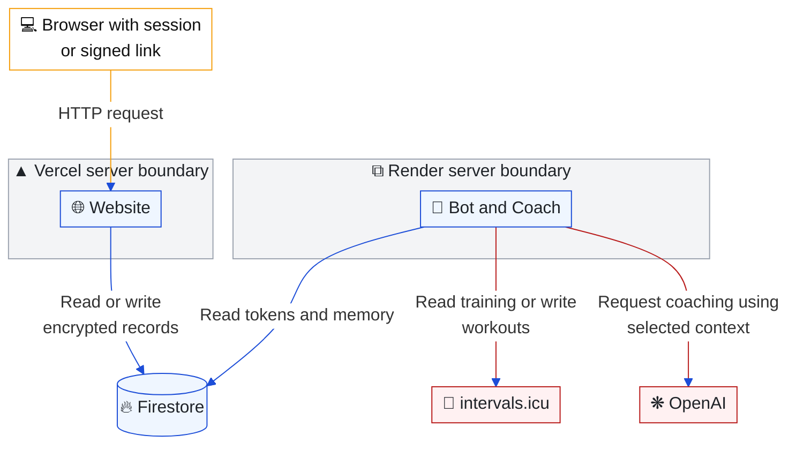

# Security boundaries

[Architecture index](README.md) · Parent: [overview](overview.md) · Related: [identity and membership](identity-membership.md), [data ownership](data.md)

This page describes checks present in code. It does not assert that every route has equivalent protection, that deployed settings match this checkout, or that the system has undergone a security audit.

## Website login: how does Discord identity become two sessions?

Purpose: distinguish the NextAuth JWT used by website routes from Firebase Auth used by older browser features.



<details>
<summary>Copy Mermaid code for mermaid.ai/live</summary>

```text
---
config:
  theme: base
  themeVariables:
    primaryColor: '#eff6ff'
    primaryTextColor: '#1f2328'
    primaryBorderColor: '#1d4ed8'
    lineColor: '#1d4ed8'
    actorBkg: '#eff6ff'
    actorBorder: '#1d4ed8'
    actorLineColor: '#1d4ed8'
    signalColor: '#1d4ed8'
  sequence:
    messageFontSize: 12
    actorMargin: 20
    width: 120
    wrap: true
  themeCSS: |
    .actor-line { stroke-width: 0.5px !important; }
    .messageText { font-size: 12px !important; }
    :is(&) { background: #ffffff; }
    rect.actor[name="D"] { stroke: #b91c1c !important; fill: #fff1f2 !important; }
    .actor-line[name="D"] { stroke: #b91c1c !important; }
    [data-from="D"], [data-to="D"] { stroke: #b91c1c !important; }
---
sequenceDiagram
    participant B as 💻 Browser
    participant N as 🌐 NextAuth and website API
    participant D as 🎮 Discord
    participant F as 🔥 Firestore
    participant A as 🔥 Firebase Auth
    rect rgb(255, 255, 255)
    B->>N: Sign in with Discord
    N->>D: OAuth identity and guild member roles
    Note over N,D: Bot-token role lookup is a fallback
    alt No accepted verified role
        N->>F: Check current-year paid membership
    end
    Note over N,B: JWT with Discord ID, roles, admin and paid-access flags
    B->>N: GET auth/firebase-token using website session
    N->>A: Resolve or create Firebase UID and mint custom token
    N->>F: Save users/discordId linkage
    Note over N,B: Custom token
    B->>A: Firebase SDK sign-in
    end
```

</details>

Sources: [NextAuth callbacks](../../app/api/auth/[...nextauth]/route.ts), [Firebase-token route](../../app/api/auth/firebase-token/route.ts), [AuthContext bridge](../../components/auth/AuthContext.js). Login requests `identify email guilds.members.read`. Admission is an accepted verified role **or** paid membership. The paid flag is evaluated as a fallback, so `membershipActive: false` in a JWT does not prove a verified member is unpaid.

Roles/admin status are captured when the OAuth account is handled; the code does not continuously refresh those JWT claims from Discord. Role removal is not an immediate revocation mechanism for existing sessions. Paid Coach routes independently consult current data. The Firebase bridge skips sign-in if a Firebase user already exists; it is not a continuous reconciliation of the two sessions.

## Access decisions: which gate applies?

| Surface | Implemented gate | Reference |
| --- | --- | --- |
| `/members-zone/**` | JWT, accepted verified role or paid-access flag; `/members-zone/about` is public | [middleware](../../middleware.ts) |
| `/admin/**` | JWT `isAdmin`; event pages add configured editor identity | [middleware](../../middleware.ts) |
| `/api/admin/**` | Explicit `requireAdmin` or `requireEventEditor` in each handler | [admin guards](../../app/api/admin/_lib/auth.ts) |
| Team management | Admin, or captain role plus configured team ownership in mutation routes | [team routes](../../app/api/team/) |
| Coach settings, notes and training tools | Discord identity plus current paid coverage; tool-specific consent | [Coach routes](../../app/api/coach/), [bot handler](../../apps/bot/handlers/aiChatHandler.js) |
| Member calendar | Session Discord ID scopes the member's own subcollection; goals additionally paid-gated | [calendar route](../../app/api/calendar/route.ts) |
| Public join session | Signed onboarding cookie and per-step checks; separate from NextAuth | [session helpers](../../app/api/onboarding/_lib/session.ts) |
| intervals.icu connection | Signed expiring link or website session; paid recheck at connect/callback | [intervals routes](../../app/api/intervals/) |
| Flask service routes | Explicit bearer `CONTENT_API_KEY` checks; retired session routes return `410` | [Flask main](../../apps/api/main.py) |
| Weekly-series cron | Dedicated bearer `WEEKLY_SERIES_CRON_SECRET` | [cron route](../../app/api/cron/weekly-series/route.ts) |
| Browser Firestore | Firebase Auth and collection rules, not the website's admin JWT | [rules](../../firestore.rules) |
| Streaming enrollment/removal | Both commands and effectful components require the configured Club Member role; private owner-bound responses; role visibility must also be granted in Discord Integrations | [streaming handlers](../../apps/bot/handlers/streamingHandlers.js) |
| Streaming overview | Administrator permission or configured DZR Admin role, checked on execution | [streaming handlers](../../apps/bot/handlers/streamingHandlers.js) |
| OBS callback | Per-member hashed bearer key, registered platform, validated payload, size/rate limits; provider verification before posting | [streaming guide](streaming.md) |

Middleware matches **pages only**. A protected UI does not authorize the HTTP endpoint it calls. Before extending a route, inspect the actual route guard; [known exceptions](#existing-boundaries-and-limitations) are part of the current architecture.

## Secrets and training data: where does trust change?

Purpose: identify website-to-Coach trust boundaries and where training data leaves DZR.



<details>
<summary>Editable Mermaid source</summary>



</details>

The website and bot initialize Admin SDKs with server credentials; Google Cloud Run uses Application Default Credentials. Firebase client configuration is public configuration, while private keys, Discord tokens, service keys, OAuth client secrets and athlete tokens belong on servers. Admin SDKs bypass Firestore rules.

Shared [tokenCrypto](../../packages/shared/coach/tokenCrypto.js) derives AES-256-GCM keys. Token material prefers `COACH_TOKEN_KEY`, otherwise a domain-separated `COACH_CONNECT_SECRET`; memory prefers `COACH_MEMORY_KEY`, then a domain-separated connect secret, then token-key fallback. Connect links always use `COACH_CONNECT_SECRET`. New protected writes require keys; readers accept legacy plaintext for migration. Metadata and numerical caches do not all use the same encryption envelope.

Vercel and Render must agree on the effective keys. The bot's [startup canary](../../apps/bot/bot.js) checks stored Coach memory: a mismatch exits; an unavailable Firestore check warns. This does not prove every historical document can decrypt. Changing a shared key is a coordinated data migration, not an ordinary configuration rename.

At-rest encryption does not prevent data being decrypted for a coaching turn. Selected training context and permitted memory go to OpenAI, and the visible answer goes to Discord. `store: false` in [coachLlm](../../apps/bot/services/coachLlm.js) describes the API request setting; it is not a claim that provider logs, Discord history or all local operational records are erased.

## Existing boundaries and limitations

- [sendMessage](../../app/api/discord-bot/sendMessage/route.ts) performs Discord writes without an explicit session check. [checkNewMembers](../../app/api/discord-bot/checkNewMembers/route.ts), [getevents](../../app/api/getevents/route.ts) and [club-stat ingestion](../../app/api/zr/club/[club]/route.ts) also expose effectful handlers without a route-level authentication check. The middleware matcher does not cover them. Treat these as existing limitations, not patterns for new routes.
- [Membership checkout callback](../../app/api/membership/vipps-checkout/callback/route.ts) logs invalid authorization but continues; its success decision includes callback-supplied state. [Onboarding callback](../../app/api/onboarding/payment/callback/route.ts) instead acknowledges and stops on invalid authorization, then queries Vipps in its processor. These paths need separate review when changing payment behavior.
- The generic admin [collection allowlist](../../app/api/admin/_lib/collections.ts) blocks connections, profiles, notes and payments and redacts secret fields. Specialized admin routes have their own contracts; an allowlist does not authorize arbitrary collections.
- Client Firestore rules for legacy shop/ZRL allow all authenticated users to read/write their feature collections. They do not enforce captain/admin policy. `users` ownership is UID equality, which differs from Discord-ID document ownership. See [data constraints](data.md#client-rules-versus-feature-ownership).
- Onboarding and club-assistant DM tracking (`onboarding_dms`, `assistant_dm_*`) store timestamps, tools, outcomes and ratings only, never DM or reply text. Knowledge gaps hold the assistant's own topic summary without a user id. Keep it that way when extending the reporting.
- The announcement index sends announcement text and images (already public to members) to OpenAI for embeddings and image transcription, and only indexes normal posts by this bot or current Admins. Gap drafts post only the gap topic and what DZR Helper wrote to the moderators channel, never member text, and need a Manage Messages or Administrator click before they reach `bot_knowledge`.
- No consumer for `role_updates` or verified live Firestore TTL policy is established by this checkout. Missing automatic cleanup/delivery must not be represented as a guaranteed security or operational control.

Application behavior is unchanged by this documentation task. [Findings](findings.md) records these limits and legacy references for future work.
