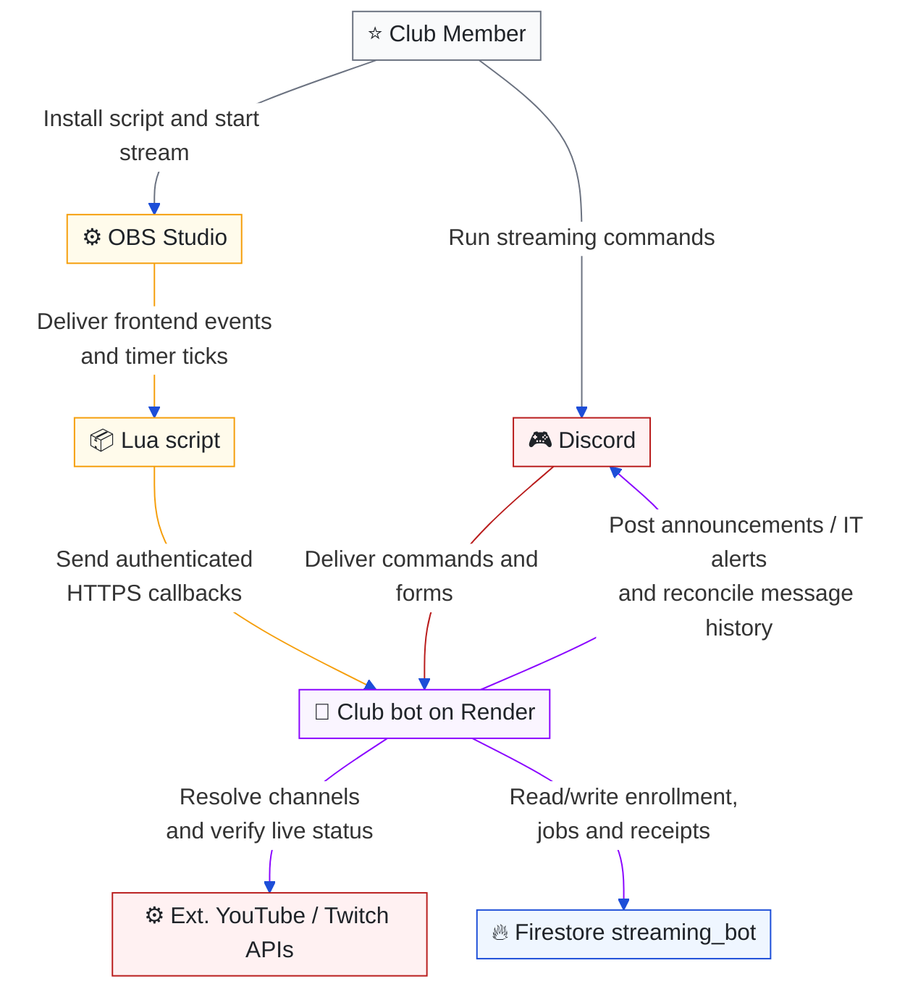
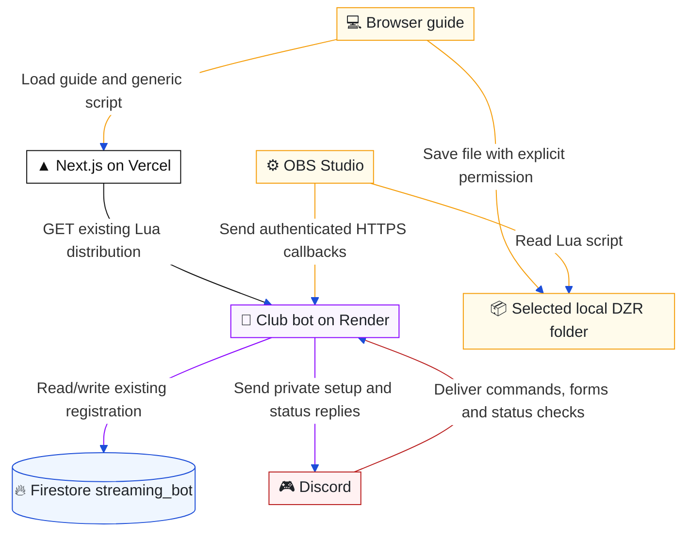

# OBS streaming announcements

[Architecture index](README.md) · Parent: [bot and automation](bot-automation.md) · Related: [security](security.md), [data](data.md), [deployment setup](../../README.md#obs-streaming), [isolated onboarding tests](../streaming-setup-testing.md)

## How does an OBS signal become one verified announcement?

Purpose: connect Club Member onboarding and OBS/Lua events to independent public live verification and Discord delivery.

Editable Mermaid source

The member installs Lua in OBS Studio. OBS dispatches frontend events and timer ticks to the script; Lua sends HTTPS callbacks to the always-on Render bot. The bot independently verifies public live status with YouTube/Twitch before posting to Discord. Next.js and Flask do not receive these callbacks. Deployment variables live in [OBS setup](../../README.md#obs-streaming).

## Member and administrator flows

`/streaming_add` opens private onboarding for members holding the configured Club Member role (`system_settings/global.membership.clubMemberRoleId`). Add and remove are visible by default and check the role at command and effectful component submission, including for administrators. Members enter YouTube/Twitch channels and receive a generic Lua download and personal key. The callback address is fixed in Lua; OBS has no endpoint field and ignores previously saved endpoint settings. Saving again replaces channels and rotates the key. Only its SHA-256 hash is stored, so a lost key requires another enrollment.

YouTube channel links may include sharing parameters, which are discarded. Members can also paste a YouTube video link: the provider resolves its video ID with `videos.list`, then fetches the channel with `channels.list`. Enrollment stores the channel ID and prefers the channel's handle URL, falling back to its `/channel/UC…` URL. Resolution never uses search or fetches a user-supplied URL.

The private OBS guide separates downloading `dzr-stream.lua`, opening **Tools / Værktøjer → Scripts**, clicking **+**, and selecting the file from **Downloads / Overførsler**. It explains the **DZR key** field, simultaneous platforms, automatic discovery of registered channels and the optional YouTube video link, then directs members to test in OBS and confirm the signal time in Discord. Keys are delivered in ephemeral replies, which can disappear; they are not ordinary DMs and the guide does not promise search-based recovery.

`/streaming_add_new` registers at normal bot startup and adds a browser guide using the same Club Member checks, modal, enrollment service, registration records, private keys and Lua distribution. New registrations get a private one-time key and guide link. Existing registrations reopen the guide without enrollment or key rotation. A `createOnly` transaction guard also preserves the registration on duplicate/stale form submissions. The original command keeps its messages and rotation behavior.

`/streaming_remove` revokes the invoking Club Member's key and sessions. Losing the role blocks enrollment/removal commands and their effectful components; it does not itself delete an existing registration. Leaving the guild revokes enrollment. `/streaming_overview [page]` requires Administrator or the configured DZR Admin role and shows Discord users, channel links, last verified live starts, broadcast links and errors. Responses are private and components are bound to their owner.

Channel ownership is trusted, without provider OAuth. Exclusive channel claims prevent two members registering the same channel; they do not prove ownership. Live verification checks the registered channel, not whether the Discord user owns it.

## How does browser setup reuse the existing bot?

Purpose: separate the browser's permitted file installation from the bot's existing registration, authentication and OBS connectivity responsibilities.

Editable Mermaid source

The public [setup page](../../app/streaming/setup/page.tsx) requires no browser login. It offers Windows/macOS instructions, explicit directory access where supported and a normal download elsewhere. The File System Access API uses the directory selected by the member; Documents is only a picker hint. It writes only the generic `dzr-stream.lua` in the selected DZR folder, preserves different existing files and keeps directory handles in memory. The browser never executes the script or changes OBS settings.

The [website download route](../../app/api/streaming/script/route.ts) requests the bot's existing Lua download server-side. The download origin defaults to `https://bot-tdnm.onrender.com`; optional `STREAMING_PUBLIC_URL` overrides this origin, and invalid overrides fail closed. This does not change the callback address embedded in Lua. The route does not forward browser credentials or accept a destination from the request. It rejects failed, empty, oversized or invalid script downloads. This avoids browser CORS restrictions without a second script copy or extra backend service.

The guide URL is generic: no key, Discord ID or registration session is appended. Members copy the private Discord key directly into OBS. Reopening the guide neither reads nor rotates a key. The guide explains that replacing a lost key through the original `/streaming_add` invalidates the old one. No key enters browser state, persistent storage, analytics or screenshots.

Finishing the guide and saving a file are distinct from a verified connection. The optional test still uses **Test forbindelse** in OBS and the existing private Discord status button; the browser does not poll personal status or mark a connection verified. No platform selector is added: upstream's automatic registered-channel discovery remains in use. [Testing and comparison](../streaming-setup-testing.md) covers automated checks, manual smoke testing and independent improvements to the original flow.

## Callback and verification contract

- `GET /streaming/dzr-stream.lua` serves the generic OBS script. It uses LuaJIT FFI/libcurl multi, without shell commands or reading stream keys. The bot discovers registered channels automatically, including when OBS uses a custom RTMP or multistream service; there is no platform selector in the new script.
- `POST /streaming/obs` accepts a bearer key and JSON up to 2 KiB: `event` (`started`, `heartbeat`, `stopped`, `test`), `sessionId`, increasing `sequence`, `startedAt` and `sentAt` (Unix milliseconds), optional YouTube `videoId` and optional legacy `platform`. The clock tolerance is two minutes. A `202` acknowledges persisted work, not an announcement.
- OBS sends 30-second heartbeats; 150 seconds without one expires undiscovered work. Missing heartbeats never start ending checks for verified streams. Retries retain session/sequence and refresh `sentAt`. Duplicate and older events are ignored. Tests update connectivity only. HTTP size and per-key/IP limits bound ingress; Express trusts one Render proxy hop so client addresses use separate buckets.

Legacy `platform` values `youtube`, `twitch`, `null` or an omitted field are accepted as hints; registered channels determine which providers are checked. Other non-null callback values remain invalid. A missing/unknown OBS service serializes as `null` and does not cause an error or require manual selection. A supplied YouTube `videoId` is carried even when the primary OBS service is Twitch or custom RTMP. Platform-specific provider operations still reject unsupported platforms.

The worker wakes every five seconds and claims due jobs with Firestore leases. Before any platform is found, it checks immediately, then uses exponential delays of **15, 30, 60, 120, 240, 300 seconds**, capped at five minutes. Both next-attempt time and attempt count survive restarts. Provider failures are retried without treating them as offline responses.

Initial discovery lasts at most **one hour from OBS start**. The first verified public platform is announced immediately and fixes a separate **five-minute additional-platform discovery window**, measured from the bot's verification time rather than provider start or Discord delivery. Remaining registered channels are polled at one-minute intervals within that window. Stop early when all platforms are found; no new discovery requests start after the deadline. Heartbeats, API failures and OBS reconnects in the same broadcast do not reset either deadline. An unused channel is hidden and does not create a timeout report when another platform was found. When no platform was found within the initial hour, the existing discovery-timeout alert remains. Delivery retries use already verified platform data without polling known streams before OBS stops.

YouTube uses search only during those callback-triggered attempts to find the concrete video; a supplied video link is checked first and skips search only when verified live on the registered channel. Otherwise live search continues, including for stale, private, unavailable or upcoming supplied links. An initial empty live search can discover upcoming IDs once. Later attempts check cached candidates first, then keep searching for live videos if none qualifies; an unrelated upcoming video cannot pin discovery to itself. Searches reserve a persisted daily budget before the API call (default 90, reset at Pacific midnight). Each search costs 100 YouTube quota units; the cap is shared across members and must fit the project's other API usage. With successful API responses and no known video or results, a full one-hour attempt uses at most 16 live searches plus one upcoming search.

YouTube requires the registered channel ID, public visibility, `liveBroadcastContent=live`, actual start and no actual end. Twitch directly checks the registered broadcaster and `type=live`, using a cached app token. OBS output and scheduled times alone never count. API/indexing delays still affect detection latency; provider classifications such as YouTube Premieres require acceptance testing.

## Durable delivery and lifecycle

The server-only `streaming_bot` collection stores member/channel claims, hashed keys, sessions and discovery schedules, search quota, announcement receipts and IT alerts. Queries use single fields; no composite indexes are needed. Self-removal deletes the registration/key and legacy sessions; retained broadcast jobs are cancelled when their registration is revoked. Broadcast/source records, receipts and alerts remain for deduplication and recovery. Firestore clients have no access.

At most one broadcast remains open per member and destination. It stores independent YouTube/Twitch state, OBS sessions, verified stream IDs/live periods, discovery/offline deadlines, recording schedules and the Discord message ID. The first platform creates the message; subsequent platforms and lifecycle changes edit it. Broadcast-ID receipts still prevent repeated delivery across OBS sessions. Firestore transactions, leases and revision checks prevent two workers or simultaneous platform checks overwriting each other. A stable Discord nonce and immutable initial payload support recovery of uncertain first sends. Incomplete history defers delivery rather than risking a duplicate. Deleted Discord messages are not recreated automatically. Old jobs and receipts remain compatible; historical messages are not bulk-edited. Registration changes/removal cancel work owned by the previous registration. An already in-flight Discord request cannot be recalled. All creates and edits disable automatic mentions.

Verified platforms receive **no background status or ending checks while OBS is live**. Only an authenticated, nonduplicate `stopped` callback for a known session can authorize ending checks. Other non-stopped sessions veto it while their last heartbeat is less than **150 seconds old**. A persisted `pendingStopAt` retains that explicit authorization until those sessions stop or expire, including across worker restarts; expiry without an explicit stop never authorizes checks. This allows a script reload followed by a real stop to recover from the old orphaned session. A continuing heartbeat cancels pending authorization; a new `started` callback or a heartbeat from a returning active source suspends already enabled checks and clears offline grace. Callback timestamps still must pass the two-minute clock tolerance; an unknown session cannot authorize completion with a stop. The Lua script already sends `stopped` for `OBS_FRONTEND_EVENT_STREAMING_STOPPED`. If that event is never received, the announcement intentionally stays LIVE indefinitely, even if the provider has ended the stream. This reduces provider API use while OBS is live. Initial discovery and the five-minute additional-platform discovery window remain as described above; they do not monitor already verified streams.

Once an explicit stop has been received and no recently active OBS session vetoes it, the bot checks verified platforms immediately and every **60 seconds** until completion. The original accepted stop time is retained for approximate duration even when the gate waits for an orphaned session to expire. A `stopped` callback does not itself mark a platform ended. A confirmed offline result opens a separate **five-minute reconnect grace period for that platform**. Its card and live button remain during grace. A verified reconnect clears the offline deadline, retains the same Discord message and updates the broadcast link/ID if needed. At grace expiry another offline response is required to end the platform. API errors mean unknown status and never alone end a stream. Once every previously verified platform is ended, the message is marked completed; a platform never found live does not keep it open. A later new OBS start opens a new broadcast.

An OBS restart suspends pending ending checks and may verify known platforms again to refresh their live links, including a new YouTube broadcast ID. This start-triggered refresh stops at the first confirmation or after five minutes, uses one-minute retries, never marks a platform offline/ended, and does not reopen the original discovery window for unused platforms. A new active source's first authenticated heartbeat also suspends ending checks.

The renderer uses fixed YouTube/Twitch ordering, platform-colored cards (`#FF0000`/`#9146FF`), status text, actual start with Discord timestamps, and a small provider thumbnail when available. Discord URL buttons have neutral backgrounds with platform-colored emoji. Thumbnails are optional and do not delay delivery. Ended cards remain with duration, excluding completion grace. Where the provider has no actual end timestamp, the received OBS stop time supplies the approximate end time; these estimates are labelled `ca.`. Each platform may be live, reconnecting or ended independently within one message.

When a platform ends, recording lookup runs immediately and at **1, 5, 15, 30 and 60 minutes** after completion, then stops. YouTube checks the known video IDs; Twitch archives must match the verified `stream_id`, never simply the newest channel video. A verified available recording replaces the live link/button. Without a recording the button and clickable title URL are removed while the ended card remains. Multiple recording parts are listed chronologically in the card; the button opens the first part.

Authenticated callback errors, provider/quota errors, discovery timeout and announcement delivery errors enqueue reports for the shared Discord IT destination (`config.discord.itChannelId`, configured by `IT_CHANNEL_ID`). Reports contain Discord identity, a sanitized error code and time, never raw request bodies, headers or keys. Repeated codes are coalesced per registration/OBS session; callback errors per registration. IT delivery is retried after one minute, with durable leases. If Firestore itself is unavailable, reporting falls back to a best-effort direct send, limited to once/minute per process. Unauthenticated bad keys do not generate reports.

## Code and validation

| Responsibility | Implementation |
| --- | --- |
| Commands, private forms, role checks | [handlers](../../apps/bot/handlers/streamingHandlers.js) |
| Public browser guide and safe generic file installation | [setup page](../../app/streaming/setup/page.tsx), [wizard](../../components/streaming/StreamingSetupWizard.tsx), [installer](../../components/streaming/installScript.ts) |
| Same-origin Lua download and common website configuration | [download route](../../app/api/streaming/script/route.ts), [configuration/download helper](../../app/lib/streamingSetup.ts) |
| Callback ingress and download | [HTTP router](../../apps/bot/services/streaming/router.js), [OBS script](../../apps/bot/assets/dzr-stream.lua) |
| Provider identity and public live checks | [providers](../../apps/bot/services/streaming/providers.js) |
| Scheduling, deadline, delivery and alerts | [worker](../../apps/bot/services/streaming/service.js), [transaction store](../../apps/bot/services/streaming/store.js) |
| Grouped multistream lifecycle, monitoring and recordings | [broadcast worker](../../apps/bot/services/streaming/broadcasts.js), [broadcast transactions](../../apps/bot/services/streaming/broadcastStore.js) |
| Discord sends and message recovery | [publisher](../../apps/bot/services/streaming/publisher.js) |
| Callback validation and announcement text | [model](../../apps/bot/services/streaming/model.js) |

Streaming tests run with the bot suite. They cover role gates, callbacks, virtual-clock discovery and reconnect boundaries, multistream, OBS stop-gated monitoring/recording schedules, quota, delivery recovery, IT reporting and proxy IP isolation. The shipped Lua is tested with mocked OBS events but real libcurl/local HTTPS under LuaJIT, including custom services and YouTube links sent with Twitch callbacks. Tests never use production Discord or Firestore. The initial one/two-streamer pilot must still exercise real OBS/public streams on members' operating systems, single/multiple platforms, staggered starts, reconnects, stop/restart gating, lost stop events, completion/recordings and Discord mobile/desktop layout. Future race/ZwiftPower enrichment belongs in the server-side message builder after verification.
