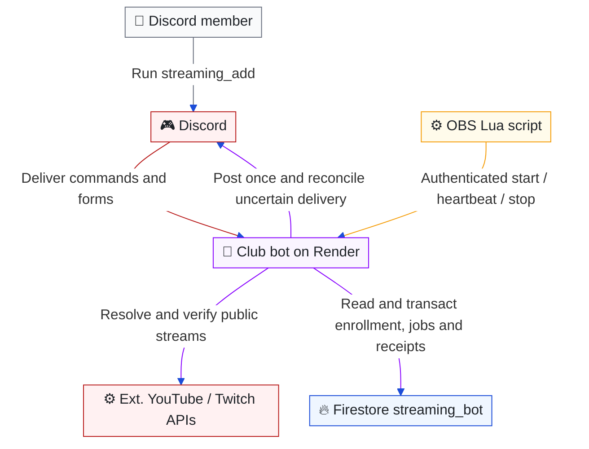

# OBS streaming announcements

[Architecture index](README.md) · Parent: [bot and automation](bot-automation.md) · Related: [security](security.md), [data](data.md), [deployment setup](../../README.md#obs-streaming)

## How does an OBS signal become one verified announcement?

Purpose: separate a broadcaster's OBS output from the provider's public live state and Discord delivery.


<details>
<summary>Editable Mermaid source</summary>



</details>

The always-on Render bot owns this feature; Next.js and Flask do not receive OBS callbacks. No provider OAuth consent is needed from members. DZR still needs a YouTube Data API key and/or Twitch application credentials for independent verification.

## Member and administrator flows

- `/streaming_add` is available to ordinary members in the configured guild. An ephemeral introduction opens a two-field modal accepting a YouTube channel URL/handle/ID and/or Twitch channel URL/login. Channel IDs are resolved through fixed provider endpoints, not by fetching arbitrary submitted URLs. At least one channel is required; a channel cannot be registered to two members in the same guild.
- Successful submission stores the Discord user, normalized channel links and a SHA-256 hash of a random 256-bit key. Only that ephemeral response contains the plaintext key, the Lua download and callback URL. Saving again replaces channels, rotates the key and invalidates previous work. Losing a reply/key requires another enrollment; keys cannot be retrieved from Firestore.
- `/streaming_remove` asks the invoking member to confirm, then atomically deletes their registration, channel claims and sessions. Previously posted Discord messages remain. Pending notices check enrollment again before sending. A message already in flight at removal cannot be recalled. Guild departure also revokes enrollment.
- `/streaming_overview [page]` requires Discord Administrator or the configured DZR Admin role at execution. Default command visibility is Administrator; Discord's integration settings can additionally grant the DZR Admin role access. The paginated private overview shows Discord identity, channel links, last verified broadcast start, last broadcast links and verification/delivery errors. An OBS test is not recorded as a livestream.
- The key grants callbacks only for that member's registered platforms. Registering a channel is a member's assertion of ownership, not OAuth proof; duplicate claims are prevented, but disputes require an administrator to investigate.

The OBS user adds one [Lua file](../../apps/bot/assets/dzr-stream.lua) in Tools → Scripts, pastes the URL and key, and tests the connection. Platform auto-detection reads only the service name; custom RTMP setups can explicitly select YouTube or Twitch. The optional **YouTube video link** is per broadcast, not a permanent channel link. It avoids discovery search and must be updated/cleared for each new broadcast. The current script supports one selected streaming destination per OBS instance, not multistream plugins.

## Callback and verification contract

`GET /streaming/dzr-stream.lua` serves the generic script. `POST /streaming/obs` requires HTTPS at the public host, a bearer key, JSON of at most 2 KiB, and a validated event:

```json
{
  "event": "started",
  "platform": "youtube",
  "sessionId": "unique_obs_session_12345",
  "sequence": 1,
  "startedAt": 1793124000000,
  "sentAt": 1793124000000,
  "videoId": "abcdefghijk"
}
```

`videoId` is optional. Event types are `started`, `heartbeat`, `stopped`, `test`. Timestamps are UTC Unix milliseconds, with a two-minute clock tolerance. Retries keep the session/sequence and refresh `sentAt`. Heartbeats are sent every 30 seconds. Duplicate/out-of-order events and late old-session stops are ignored; stopped sessions cannot be revived by delayed heartbeats. Missing heartbeats expire a session after 150 seconds. A test validates the key/platform and updates connectivity only.

HTTP requests acknowledge persisted work with `202`; they do not wait for the provider or Discord. The bot worker wakes every five seconds, queries only active sessions and pending notices, and claims only due jobs. It allows up to four concurrent verification jobs with transactional leases. Unconfirmed streams are checked every 20 seconds; verified streams every three minutes. YouTube searches are at most once/minute in the first five minutes of an OBS session, then once/two minutes while heartbeats continue. An initial empty live search may also discover upcoming video IDs, which are subsequently checked directly. A persisted daily search budget defaults to 90 and resets at Pacific midnight. Adjust it to the project's actual YouTube API quota and other API usage. Quota exhaustion is visible in the admin overview and does not trigger unchecked announcements.

YouTube requires the registered channel ID, public visibility, `liveBroadcastContent=live`, `actualStartTime`, and no `actualEndTime`. Twitch requires the registered broadcaster ID and `type=live`; application tokens are cached and refreshed. Scheduled time and OBS's output state never count as public live verification. A known YouTube video ID bypasses search entirely. Provider indexing/API delays mean these intervals are targets, not a hard latency guarantee. YouTube Premieres and other provider edge cases must be included in acceptance testing; the public API's live classification is the available signal.

## Durable delivery and lifecycle

The server-only `streaming_bot` collection has typed documents for members, exclusive channel claims, per-platform sessions, announcement receipts and daily quota. `member_<guildId>_<discordId>` ties the feature to the existing Discord→Zwift identity without adding race integration yet. No new composite indexes are required.

Announcements use a stable key from destination channel + provider + broadcast ID, independent of callback/session IDs. A Firestore outbox reserves each broadcast before sending and stores Discord's receipt. Discord receives a stable nonce with `enforceNonce`; after an uncertain send or restart, the worker searches the bot's messages by verified URL/start timestamp before retrying. If it cannot establish whether delivery happened, it leaves the notice pending and reports an error rather than blindly duplicate it. Delayed delivery is reverified; ended streams and revoked/expired sessions are cancelled. Receipt records persist across enrollment changes, so re-enrollment does not reannounce an already announced broadcast. Messages disable automatic mentions.

Member removal deletes their key, channel mapping and sessions; minimal receipt/history and daily quota records remain for deduplication. There is no client Firestore access, no plaintext key recovery endpoint, no general-purpose posting endpoint, and no OBS stream key collection. Error logs contain codes, not HTTP request objects or authentication headers. Request size, IP/key throttles and the global search budget bound external work. Production credentials belong only to Render environment variables.

## Validation and operational limits

Unit tests cover enrollment, authorization, key rotation/removal, stale events, real store transaction logic through an atomic in-memory adapter, live predicates, budgets and uncertain-delivery recovery. HTTP tests exercise the callback and script download locally. The Lua transport test runs the shipped script under LuaJIT, with mocked OBS UI/events but real libcurl multi and a local trusted HTTPS server; it covers a failed request/retry and start/heartbeat/stop. CI installs LuaJIT/libcurl for this check. No tests connect to production Discord, Firestore or streaming accounts.

Windows/macOS OBS installations and real public streams still require an acceptance run. The script loads libcurl through LuaJIT FFI (OBS's Windows library, the macOS system library, or Linux libcurl). It reports missing transport libraries in the OBS script log, uses TLS verification, and does not shell out. Native OBS rendering behavior cannot be established by a mocked frontend test.

Before rollout, test a scheduled-but-not-started YouTube stream, public start, OBS reconnect, OBS restart, provider/Discord outage, key rotation and self-removal. Compare actual provider start with Discord message time. A bot outage longer than the heartbeat grace can suppress pending notices until another heartbeat arrives. A missing optional YouTube video link leaves discovery dependent on search indexing and quota. No race matching or ZwiftPower message enrichment is implemented yet; future enrichment belongs in the server-side message builder after verification.

Implementation: [Discord handlers](../../apps/bot/handlers/streamingHandlers.js), [command declarations](../../apps/bot/commands/slashCommands.js), [callback router](../../apps/bot/services/streaming/router.js), [providers](../../apps/bot/services/streaming/providers.js), [worker](../../apps/bot/services/streaming/service.js), [transaction store](../../apps/bot/services/streaming/store.js), [Discord delivery](../../apps/bot/services/streaming/publisher.js), [message model](../../apps/bot/services/streaming/model.js).
