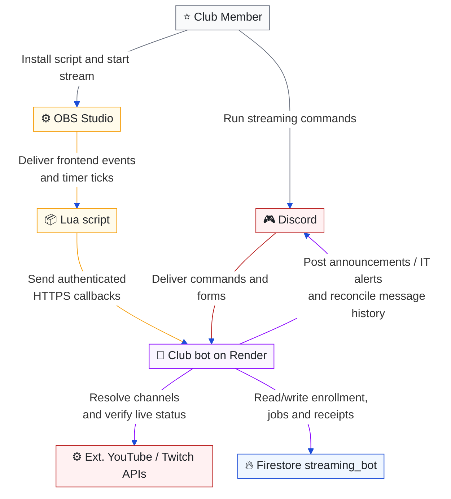

# OBS streaming announcements

[Architecture index](README.md) · Parent: [bot and automation](bot-automation.md) · Related: [security](security.md), [data](data.md), [deployment setup](../../README.md#obs-streaming)

## How does an OBS signal become one verified announcement?

Purpose: connect Club Member onboarding and OBS/Lua events to independent public live verification and Discord delivery.

Editable Mermaid source

The member installs Lua in OBS Studio. OBS dispatches frontend events and timer ticks to the script; Lua sends HTTPS callbacks to the always-on Render bot. The bot independently verifies public live status with YouTube/Twitch before posting to Discord. Next.js and Flask do not receive these callbacks. Deployment variables, Discord command visibility and the pilot checklist live in [OBS setup](../../README.md#obs-streaming).

## Member and administrator flows

`/streaming_add` opens private onboarding for members holding the configured Club Member role (`system_settings/global.membership.clubMemberRoleId`). Both add and remove check the role at command and effectful component submission; administrators have no role bypass. Members enter YouTube/Twitch channels and receive a generic Lua download, callback URL and personal key. Saving again replaces channels and rotates the key. Only its SHA-256 hash is stored, so a lost key requires another enrollment.

`/streaming_remove` revokes the invoking Club Member's key and sessions. Losing the role blocks both commands and their effectful components; it does not itself delete an existing registration. Leaving the guild revokes enrollment. `/streaming_overview [page]` requires Administrator or the configured DZR Admin role and shows Discord users, channel links, last verified live starts, broadcast links and errors. Responses are private and components are bound to their owner.

Command visibility and execution authorization are separate. Add/remove declare `default_member_permissions: "0"`; an administrator must grant the Club Member role access in Discord's Integrations settings. `setDefaultMemberPermissions` accepts permission bits, not role IDs. Discord administrators bypass command visibility restrictions, but the handler still requires Club Member for add/remove.

Channel ownership is trusted, without provider OAuth. Exclusive channel claims prevent two members registering the same channel; they do not prove ownership. Live verification checks the registered channel, not whether the Discord user owns it.

## Callback and verification contract

- `GET /streaming/dzr-stream.lua` serves the generic OBS script. It uses LuaJIT FFI/libcurl multi, without shell commands or reading stream keys. One platform is selected per OBS instance; multistream plugins are outside this flow.
- `POST /streaming/obs` accepts a bearer key and JSON up to 2 KiB: `event` (`started`, `heartbeat`, `stopped`, `test`), `platform`, `sessionId`, increasing `sequence`, `startedAt` and `sentAt` (Unix milliseconds), plus optional YouTube `videoId`. The clock tolerance is two minutes. A `202` acknowledges persisted work, not an announcement.
- OBS sends 30-second heartbeats; 150 seconds without one expires the session. Retries retain session/sequence and refresh `sentAt`. Duplicate and older events are ignored. Tests update connectivity only. HTTP size and per-key/IP limits bound ingress; Express trusts one Render proxy hop so client addresses use separate buckets.

Platform handling is explicit: `youtube`, `twitch`, or `null` in the callback (`nil` inside Lua). Failed auto-detection, a missing OBS service or an unsupported manual value becomes `nil` in Lua and JSON `null`; the script still sends the authenticated callback so DZR can report the issue. The backend rejects all unsupported values with `unknown_platform`, coalesces the IT report and creates no verification session. Provider dispatch and announcement creation also reject unsupported platforms. Selecting YouTube/Twitch manually repairs an unknown active OBS session while preserving its original start time.

The worker wakes every five seconds and claims due jobs with Firestore leases, with up to four verification jobs concurrently. It checks immediately, then uses exponential delays of **15, 30, 60, 120, 240, 300 seconds**, capped at five minutes. Both next-attempt time and attempt count survive restarts. Provider failures use the same backoff.

The discovery deadline is **one hour from OBS start**. Heartbeats do not reset it. Expired sessions cannot resume through heartbeats; a newer OBS session starts a new window. A provider response arriving after the deadline cannot enqueue an announcement. Successful verification stops discovery. A notice verified within the window may be delivered later, but delayed delivery must reverify the stream.

YouTube uses search only during those callback-triggered attempts to find the concrete video; a supplied video link skips search. An initial empty live search can discover upcoming IDs once, then check their status directly. Searches reserve a persisted daily budget before the API call (default 90, reset at Pacific midnight). Each search costs 100 YouTube quota units; the cap is shared across members and must fit the project's other API usage. With successful API responses and no known video or results, a full one-hour attempt uses at most 16 live searches plus one upcoming search.

YouTube requires the registered channel ID, public visibility, `liveBroadcastContent=live`, actual start and no actual end. Twitch directly checks the registered broadcaster and `type=live`, using a cached app token. OBS output and scheduled times alone never count. API/indexing delays still affect detection latency; provider classifications such as YouTube Premieres require acceptance testing.

## Durable delivery and lifecycle

The server-only `streaming_bot` collection stores member/channel claims, hashed keys, sessions and discovery schedules, search quota, announcement receipts and IT alerts. Queries use single fields; no composite indexes are needed. Keys and old sessions are removed on self-removal; minimal receipts and alert records remain for deduplication. Firestore clients have no access.

Announcement identity is destination + provider + broadcast ID, independent of OBS sessions. A transactional outbox, stable Discord nonce and stored message receipt prevent routine duplicate delivery. After uncertain sends, the worker reconciles the bot's channel history before retrying. Incomplete history defers delivery rather than risking a duplicate. Revoked or stale sessions and ended streams cancel pending work; an already in-flight Discord request cannot be recalled. Messages disable automatic mentions.

Authenticated callback errors, provider/quota errors, discovery timeout and announcement delivery errors enqueue reports for the shared Discord IT destination (`config.discord.itChannelId`, configured by `IT_CHANNEL_ID`). Reports contain Discord identity, a sanitized error code and time, never raw request bodies, headers or keys. Repeated codes are coalesced per registration/OBS session; callback errors per registration. IT delivery is retried after one minute, with durable leases. If Firestore itself is unavailable, reporting falls back to a best-effort direct send, limited to once/minute per process. Unauthenticated bad keys do not generate reports.

## Code and validation

| Responsibility | Implementation |
| --- | --- |
| Commands, private forms, role checks | [handlers](../../apps/bot/handlers/streamingHandlers.js) |
| Callback ingress and download | [HTTP router](../../apps/bot/services/streaming/router.js), [OBS script](../../apps/bot/assets/dzr-stream.lua) |
| Provider identity and public live checks | [providers](../../apps/bot/services/streaming/providers.js) |
| Scheduling, deadline, delivery and alerts | [worker](../../apps/bot/services/streaming/service.js), [transaction store](../../apps/bot/services/streaming/store.js) |
| Discord sends and message recovery | [publisher](../../apps/bot/services/streaming/publisher.js) |
| Callback validation and announcement text | [model](../../apps/bot/services/streaming/model.js) |

Streaming tests run with the bot suite. They cover role gates, callbacks, virtual-clock backoff/deadline boundaries and restarts, planned versus live states, quota, delivery recovery, IT reporting and proxy IP isolation. The shipped Lua is tested with mocked OBS events but real libcurl/local HTTPS under LuaJIT. Tests never use production Discord or Firestore. The initial one/two-streamer pilot must still exercise real OBS and public streams on the operating systems members use. Future race/ZwiftPower enrichment belongs in the server-side message builder after verification.
