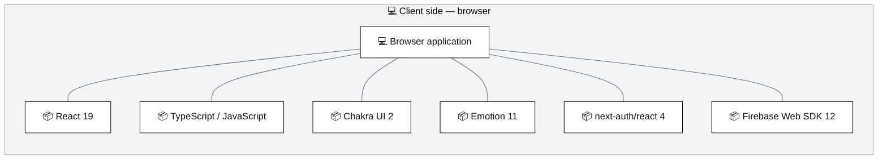
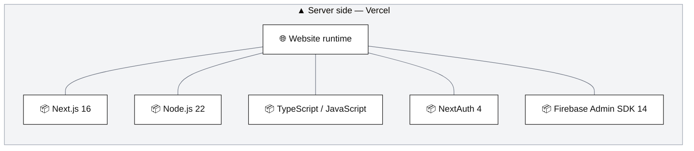
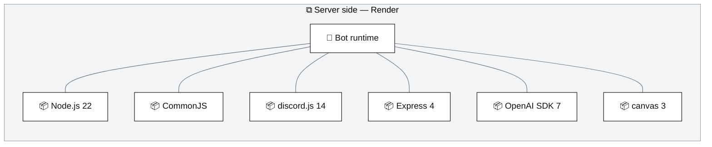
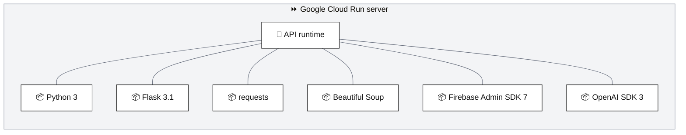

# Technology stack and execution zones

[Architecture index](README.md) · Parent: [system overview](overview.md) · Related: [code map](code-map.md), [deployment evidence](operations.md)

DZR uses separate browser, server and managed-service execution zones. These diagrams identify the libraries that define those boundaries; they do not enumerate every installed package. Versions below come from declared package ranges, lockfiles, Python requirements and Node version files at the documented baseline. They are not a report from running production instances.

## Website stack: which code runs in the browser and on Vercel?

Purpose: relate the website's browser libraries to their matching server responsibilities and Firebase services. Every arrow is an initiated request or SDK call.

The browser executes React components and client SDKs; it does not run Node.js, Flask or Firebase Admin. Next.js also renders server components and runs route handlers on Vercel. NextAuth has both a browser package and server callbacks; the [authentication sequence](security.md#website-login-how-does-discord-identity-become-two-sessions) shows how its JWT session becomes a Firebase custom-token session.

Firestore and Storage are managed services, not processes running inside Vercel. Firebase client configuration is public; the Admin SDK and private credentials stay on servers. The diagram's Firebase boxes represent DZR's configured services/data and remain blue. Third-party APIs such as Discord are red in the [runtime overview](overview.md#runtime-collaboration-what-actually-calls-what).

Member calendar and Coach settings use server APIs. The browser Firestore edge is specifically the existing shop/ZRL path, governed by Firestore rules. The server routes also integrate with the Flask API and external providers; those requests are expanded in the [runtime overview](overview.md) and feature guides instead of repeating them here.

Evidence: [root package](../../package.json), [root lockfile](../../package-lock.json), [.nvmrc](../../.nvmrc), [providers](../../app/providers.tsx), [AuthContext](../../components/auth/AuthContext.js), [Firebase client](../../app/utils/firebaseConfig.js), [Firebase Admin setup](../../app/utils/firebaseAdminConfig.js), [Next configuration](../../next.config.mjs).

## Bot and integration stack: what runs on Render and Google Cloud Run?

Purpose: distinguish the two server stacks, their clients and their shared managed data. Arrows identify request recipients; outcomes return on the same interaction.

Render and Google Cloud Run do not serve another DZR browser application. People reach bot features through Discord's own desktop/web/mobile clients, and administrative integration features through the Next.js website. The bot opens Discord gateway connections and hosts only an Express health route. Flask exposes the integration/job HTTP API; its old human admin UI is retired. Python 3's exact minor version is not pinned in a checked-in runtime definition.

The bot also calls intervals.icu directly for Coach, DCU for race information and the website for route profiles and weekly automation. Flask also has Discord REST and legacy commentary paths. These selective stack diagrams show the principal boundaries; [Coach](coach.md), [Ladder](bot-automation.md#ladder-how-is-a-match-preview-built), [Flask modules](code-map.md#flask-modules-where-do-integration-changes-belong) and [findings](findings.md) describe the remaining interfaces and incomplete paths.

Evidence: [bot package](../../apps/bot/package.json), [bot lockfile](../../apps/bot/package-lock.json), [Node version](../../apps/bot/.nvmrc), [Render definition](../../render.yaml), [bot entry point](../../apps/bot/bot.js), [health server](../../apps/bot/services/server.js), [Python requirements](../../apps/api/requirements.txt), [Flask entry point](../../apps/api/main.py), [ADC initialization](../../apps/api/firebase.py).

## Infrastructure inventory: which provider owns each execution zone?

| Provider | DZR responsibility hosted there | Client/browser counterpart |
| --- | --- | --- |
| ▲ Vercel | Root Next.js site, server components and HTTP routes | React UI and NextAuth/Firebase client libraries delivered to the browser |
| ⧉ Render | Persistent Node.js bot process; club and optional Coach Discord clients | No additional DZR browser bundle; Discord clients and the website provide user interfaces |
| ⏩ Google Cloud Run | Python Flask integration/job API, documented service `zwiftpower` | No separate DZR browser bundle; website and bot are API clients |
| 🔥 Firebase / Google Cloud | Firestore, Firebase Auth and Storage | Firebase Web SDK for Auth and legacy shop/ZRL; newer data features use DZR server APIs |
| 🐙 GitHub | Source and 🛠️ Actions validation workflows | Developer repository/PR interface; not a production DZR client runtime |

The [operations guide](operations.md) separates checked-in deployment evidence from provider-dashboard settings that remain unverified. The root [README](../../README.md) keeps installation and configuration instructions; the [Mermaid skill](../../.agents/skills/mermaid-architecture/SKILL.md) keeps the icon legend.
